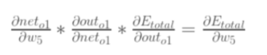

# 04 损失函数与优化方法

> **对应课程**：黑马《神经网络与深度学习》Day04–Day05（分P 44–68）
> **覆盖内容**：神经网络搭建与参数计算 · 损失函数（交叉熵 / MAE / MSE / Smooth L1）· 反向传播 BP · 优化器（动量 / AdaGrad / RMSProp / Adam）· 学习率衰减
> **整理日期**：2026-10-15

---

##  神经网络搭建和参数计算

###  构建神经网络模型

```python
import torch
import torch.nn as nn  # 线性模型和初始化方法


# todo:1-创建类继承 nn.module类
class ModelDemo(nn.Module):
	# todo:2-定义__init__构造方法, 构建神经网络
	def __init__(self):
		# todo:2-1 调用父类的__init__方法
		super().__init__()
		# todo:2-2 创建隐藏层和输出层  定义属性
		# in_features: 输入特征数(上一层神经元个数)
		# out_features: 输出特征数(当前层神经元个数)
		self.linear1 = nn.Linear(in_features=3, out_features=3)
		self.linear2 = nn.Linear(in_features=3, out_features=2)
		self.output = nn.Linear(in_features=2, out_features=2)
		# todo:2-3 对隐藏层进行参数初始化
		# self.linear1.weight: 在类的内部调用对象属性
		nn.init.xavier_normal_(tensor=self.linear1.weight)
		nn.init.zeros_(tensor=self.linear1.bias)
		nn.init.kaiming_normal_(tensor=self.linear2.weight, nonlinearity='relu')
		nn.init.zeros_(tensor=self.linear2.bias)

	# todo:3-定义前向传播方法 forward(方法名固定) 得到预测y值
	def forward(self, x):  # x->输入样本的特征值
		# todo:3-1 第一层计算 加权求和值计算  激活值计算
		x = torch.sigmoid(input=self.linear1(x))
		# todo:3-2 第二层计算
		x = torch.relu(input=self.linear2(x))
		# todo:3-3 输出层计算  假设多分类问题
		# dim=-1: 按行计算, 一个样本一个样本算
		x = torch.softmax(input=self.output(x), dim=-1)
		# 返回预测值
		return x


if __name__ == '__main__':
	# 创建神经网络模型对象
	my_model = ModelDemo()
```

### 计算和查看模型参数

```python
# 创建模型预测函数
def train():
	# todo:1-创建神经网络模型对象
	my_model = ModelDemo()
	print('my_model->', my_model)
	# todo:2-构造数据集样本, 随机生成
	data = torch.randn(size=(5, 3))
	print('data->', data)
	print('data.shape->', data.shape)
	# todo:3-调用神经网络模型对象进行模型训练
	output = my_model(data)
	print('output->', output)
	print('output.shape->', output.shape)
	# todo:4-计算和查看模型参数
	print(('====================计算和查看模型参数==================='))
	# input_size: 样本的特征数
	# batch_size: 批量训练的样本数
	# summary(model=my_model, input_size=(3,), batch_size=5)
	summary(model=my_model, input_size=(5, 3))
	for name, param in my_model.named_parameters():
		print('name->', name)
		print('param->', param)


if __name__ == '__main__':
	train()
```

## 损失函数

### 什么是损失函数

- 衡量模型参数质量的函数(评估模型)
- 对比模型预测值和真实值差异
- 指导通过梯度下降法计算梯度, 进行参数更新  loss.backward()

###  分类任务损失函数

#### 多分类任务损失函数

- 适用于多分类问题
- 计算出损失值后续结合梯度下降法和反向传播算法, 进行梯度更新
- nn.CrossEntropyLoss()

```python
# 适用于多分类
import torch
import torch.nn as nn


def dm01():
	# 手动创建样本的真实y值
	# y_true = torch.tensor(data=[[0, 1, 0], [1, 0, 0]], dtype=torch.float32)
	y_true = torch.tensor(data=[1, 2])
	print('y_true->', y_true.dtype)
	# 手动创建样本的预测y值 -> 模型预测值
	y_pred = torch.tensor(data=[[0.1, 0.8, 0.1], [0.7, 0.2, 0.1]], requires_grad=True, dtype=torch.float32)
	# 创建多分类交叉熵损失对象
	# reduction:损失值计算的方式, 默认mean 平均损失值
	criterion = nn.CrossEntropyLoss(reduction='sum')
	# 调用损失对象计算损失值
	# 预测y  真实y
	loss = criterion(y_pred, y_true)
	print('loss->', loss)


if __name__ == '__main__':
	dm01()
```

####  二分类任务损失函数

- 适用于二分类问题
- nn.BCEloss()

```python
# 适用于二分类
import torch
import torch.nn as nn


def dm01():
	# 手动创建样本的真实y值
	y_true = torch.tensor(data=[0, 1, 0], dtype=torch.float32)
	print('y_true->', y_true.dtype)
	# 手动创建样本的预测y值 -> 模型预测值
	# 0.6901, 0.5459, 0.2469 -> sigmoid函数的激活值
	y_pred = torch.tensor(data=[0.6901, 0.5459, 0.2469], requires_grad=True, dtype=torch.float32)
	# 创建多分类交叉熵损失对象
	# reduction:损失值计算的方式, 默认mean 平均损失值
	criterion = nn.BCELoss()
	# 调用损失对象计算损失值
	# 预测y  真实y
	loss = criterion(y_pred, y_true)
	print('loss->', loss)
	print('loss->', loss.requires_grad)


if __name__ == '__main__':
	dm01()
```

### 回归任务损失函数

####  MAE回归损失函数

- loss=(|y真实-y预测| + ...)/n
- 导数为-1或1, 0点位置不可导

```python
# 适用于回归任务
# MAE:导数为-1/1 0点位置不可导,一般取0作为导数
import torch
import torch.nn as nn


def dm01():
	# 手动创建样本的真实y值
	y_true = torch.tensor(data=[1.2, 1.5, 2.0], dtype=torch.float32)
	print('y_true->', y_true.dtype)
	# 手动创建样本的预测y值 -> 模型预测值
	# 0.6901, 0.5459, 0.2469 -> sigmoid函数的激活值
	y_pred = torch.tensor(data=[1.3, 1.7, 2.0], requires_grad=True, dtype=torch.float32)
	# 创建回归任务MAE损失对象
	# reduction:损失值计算的方式, 默认mean 平均损失值
	criterion = nn.L1Loss()
	# 调用损失对象计算损失值
	# 预测y  真实y
	loss = criterion(y_pred, y_true)
	print('loss->', loss)
	print('loss->', loss.requires_grad)


if __name__ == '__main__':
	dm01()
```

#### MSE损失函数

- 数据集中有异常(噪声)样本, 影响结果, 误差放大, 容易产生梯度爆炸
- 任意位置可导, 越接近底部, 导数越小, 符合梯度下降套路, 可以找到最小值

```python
# 适用于回归任务, 如果数据集有异常样本, 放大误差, 有可能导致梯度爆炸
# MSE: 任意位置都可导, 越接近底部, 导数越小
import torch
import torch.nn as nn


def dm01():
	# 手动创建样本的真实y值
	y_true = torch.tensor(data=[1.2, 1.5, 2.0], dtype=torch.float32)
	print('y_true->', y_true.dtype)
	# 手动创建样本的预测y值 -> 模型预测值
	# 0.6901, 0.5459, 0.2469 -> sigmoid函数的激活值
	y_pred = torch.tensor(data=[1.3, 1.7, 2.0], requires_grad=True, dtype=torch.float32)
	# 创建回归任务MAE损失对象
	# reduction:损失值计算的方式, 默认mean 平均损失值
	criterion = nn.MSELoss()
	# 调用损失对象计算损失值
	# 预测y  真实y
	loss = criterion(y_pred, y_true)
	print('loss->', loss)
	print('loss->', loss.requires_grad)


if __name__ == '__main__':
	dm01()
```

#### Smooth L1损失函数

- 中和MAE和MSE, w小于-1或w大于1使用MAE, w在[-1,1]范围内使用MSE
- 不受异常值影响,不容易产生梯度爆炸,在任意位置可导,可以找到最小值
- nn.SmoothL1()

```python
# 适用于回归任务, 不受异常值影响
# smooth l1: 任意位置都可导, 越接近底部, 导数越小
import torch
import torch.nn as nn


def dm01():
	# 手动创建样本的真实y值
	y_true = torch.tensor(data=[1.2, 1.5, 2.0], dtype=torch.float32)
	print('y_true->', y_true.dtype)
	# 手动创建样本的预测y值 -> 模型预测值
	# 0.6901, 0.5459, 0.2469 -> sigmoid函数的激活值
	y_pred = torch.tensor(data=[1.3, 1.7, 2.0], requires_grad=True, dtype=torch.float32)
	# 创建回归任务smoothl1损失对象
	# reduction:损失值计算的方式, 默认mean 平均损失值
	criterion = nn.SmoothL1Loss()
	# 调用损失对象计算损失值
	# 预测y  真实y
	loss = criterion(y_pred, y_true)
	print('loss->', loss)
	print('loss->', loss.requires_grad)


if __name__ == '__main__':
	dm01()
```

##  神经网络优化方法

### 梯度下降算法回顾

- W = W - lr * grad

- 梯度下降算法是一种寻找最优网络参数的策略, 计算每次损失值对应的梯度, 进行参数更新
  - BGD, 使用全部样本计算梯度, 计算量大
  - SGD, 使用全部样本中随机一个样本计算梯度, 梯度可能不合理
  - Min-Batch, 使用一批样本计算梯度, 计算量相对小, 梯度更加合理

### 反向传播算法(BP算法)

- 反向传播就是算当前损失值和参数的导数(梯度), 需要借助梯度连乘的方式

  

- 结合梯度下降算法更新参数  W1 = W0 - LR * 梯度 -> W0和LR已知, 梯度根据BP算法计算出

### 梯度下降优化方法

> 避免遇到鞍点以及局部最小值情况

####  指数移动加权平均

- $$S_t​$$ = $(1-β)Y_t​$ + $$βS_{t-1}​$$

- S100 = `0.1*Y100 + 0.1*0.9*Y99 + 0.1*0.9*0.9*Y98 + ....`
- β值越大, 受当前时刻真实值越小, 一般0.9

#### 动量算法Momentum

- $$S_t$$ = $(1-β)g_t$ + $$βS_{t-1}$$

  ```python
  # 动量法计算梯度实际上计算的是当前时刻的指数移动加权平均梯度值
  import torch
  from torch import optim
  
  
  def dm01():
  	# todo: 1-初始化权重参数
  	w = torch.tensor([1.0], requires_grad=True, dtype=torch.float32)
      # 自定义损失函数, 实际工作中调用不同任务的损失函数, 交叉熵损失/MSE损失...
  	loss = ((w ** 2) / 2.0).sum()
  	# todo: 2-创建优化器函数对象 SGD->动量法
  	# momentum: 动量法, 一般0.9或0.99
  	optimizer = optim.SGD([w], lr=0.01, momentum=0.9)
  	# todo: 3-计算梯度值
  	optimizer.zero_grad()
  	loss.sum().backward()
  	# todo: 4-更新权重参数 梯度更新
  	optimizer.step()
  	print('w.grad->', w.grad)
      # 第二次计算
      loss = ((w ** 2) / 2.0).sum()
      optimizer.zero_grad()
      loss.backward()
      optimizer.step()
      print('w.grad->', w.grad)
  
  
  if __name__ == '__main__':
  	dm01()
  ```

####  AdaGrad

- 随着训练次数增加调整学习率, 开始学习率大, 后续学习率越来越小

  ```python
  # adagrad优化方法调整学习率, 随着训练次数增加, 学习率越来越小, 一开始的学习率比较大
  import torch
  from torch import optim
  
  
  def dm01():
  	# todo: 1-初始化权重参数
  	w = torch.tensor([1.0], requires_grad=True, dtype=torch.float32)
  	loss = ((w ** 2) / 2.0).sum()
  	# todo: 2-创建优化器函数对象 Adagrad
  	optimizer = optim.Adagrad([w], lr=0.01)
  	# todo: 3-计算梯度值
  	optimizer.zero_grad()
  	loss.sum().backward()
  	# todo: 4-更新权重参数 梯度更新
  	optimizer.step()
  	print('w.grad->', w.grad, w)
  	# 第二次计算
  	loss = ((w ** 2) / 2.0).sum()
  	optimizer.zero_grad()
  	loss.backward()
  	optimizer.step()
  	print('w.grad->', w.grad, w)
  	# 第三次计算
  	loss = ((w ** 2) / 2.0).sum()
  	optimizer.zero_grad()
  	loss.backward()
  	optimizer.step()
  	print('w.grad->', w.grad, w)
  
  
  if __name__ == '__main__':
  	dm01()
  ```

#### RMSProp

- 对adagrap优化, 使用指数移动加权平均梯度代替累加梯度

  ```python
  # rmsprop优化方法调整学习率, 对adagrad方法进行优化, 使用指数移动加权平均梯度代替历史累加梯度
  # 避免学习率过快减小, 导致后续模型收敛速度慢
  import torch
  from torch import optim
  
  
  def dm01():
  	# todo: 1-初始化权重参数
  	w = torch.tensor([1.0], requires_grad=True, dtype=torch.float32)
  	loss = ((w ** 2) / 2.0).sum()
  	# todo: 2-创建优化器函数对象  RMSprop
  	optimizer = optim.RMSprop([w], lr=0.01, alpha=0.9)
  	# todo: 3-计算梯度值
  	optimizer.zero_grad()
  	loss.sum().backward()
  	# todo: 4-更新权重参数 梯度更新
  	optimizer.step()
  	print('w.grad->', w.grad, w)
  	# 第二次计算
  	loss = ((w ** 2) / 2.0).sum()
  	optimizer.zero_grad()
  	loss.backward()
  	optimizer.step()
  	print('w.grad->', w.grad, w)
  	# 第三次计算
  	loss = ((w ** 2) / 2.0).sum()
  	optimizer.zero_grad()
  	loss.backward()
  	optimizer.step()
  	print('w.grad->', w.grad, w)
  
  
  if __name__ == '__main__':
  	dm01()
  ```

#### Adam

- 修正梯度和学习率

  ```python
  # adam既优化学习率又优化梯度  adam=rmsprop+momentum
  import torch
  from torch import optim
  
  
  def dm01():
  	# todo: 1-初始化权重参数
  	w = torch.tensor([1.0], requires_grad=True, dtype=torch.float32)
  	loss = ((w ** 2) / 2.0).sum()
  	# todo: 2-创建优化器函数对象
  	# betas: 两个β值, 接收元组类型
  	optimizer = optim.Adam([w], lr=0.01, betas=(0.9, 0.99))
  	# todo: 3-计算梯度值
  	optimizer.zero_grad()
  	loss.sum().backward()
  	# todo: 4-更新权重参数 梯度更新
  	optimizer.step()
  	print('w.grad->', w.grad, w)
  	# 第二次计算
  	loss = ((w ** 2) / 2.0).sum()
  	optimizer.zero_grad()
  	loss.backward()
  	optimizer.step()
  	print('w.grad->', w.grad, w)
  	# 第三次计算
  	loss = ((w ** 2) / 2.0).sum()
  	optimizer.zero_grad()
  	loss.backward()
  	optimizer.step()
  	print('w.grad->', w.grad, w)
  
  
  if __name__ == '__main__':
  	dm01()
  ```

####  如何选择梯度下降优化方法

- SGD和momentum适用于简单任务或浅层神经网络模型
- Adam适用于复杂任务或数据量大
- AdaGrad和RMSprop适用于文本数据处理 nlp

## 学习率衰减优化方法

###  为什么进行学习率优化

- 根据模型训练次数, 手动调整学习率, 使模型前期收敛速度快, 后期收敛速度慢

###  等间隔学习率衰减

```python
# 等间隔: 指定训练次数后修改学习率  lr=lr*gamma
import torch
from torch import optim
import matplotlib.pyplot as plt


def dm01():
	# todo: 1-初始化参数
	# lr epoch iteration
	lr = 0.1
	epoch = 200
	iteration = 10
	# todo: 2-创建数据集
	# y_true x w
	y_true = torch.tensor([0])
	x = torch.tensor([1.0], dtype=torch.float32)
	w = torch.tensor([1.0], requires_grad=True, dtype=torch.float32)
	# todo: 3-创建优化器对象 动量法
	optimizer = optim.SGD(params=[w], lr=lr, momentum=0.9)
	# todo: 4-创建等间隔学习率衰减对象
	# optimizer: 优化器对象
	# step_size: 间隔, 指定训练次数后修改学习率
	# gamma: 衰减系数 默认0.1
	scheduer = optim.lr_scheduler.StepLR(optimizer=optimizer, step_size=50, gamma=0.5)
	# todo: 5-创建两个列表, 收集训练次数, 收集每次训练lr
	lr_list, epoch_list = [], []
	# todo: 6-循环遍历训练次数
	for i in range(epoch):
		# todo: 7-获取每次训练的次数和lr保存到列表中
		# scheduer.get_last_lr(): 获取最后lr
		lr_list.append(scheduer.get_last_lr())
		epoch_list.append(i)
		# todo: 8-循环遍历, batch计算
		for batch in range(iteration):
			# 先算预测y值 wx, 计算损失值 (wx-y_true)**2
			y_pred = w * x
			loss = (y_pred - y_true) ** 2
			# 梯度清零
			optimizer.zero_grad()
			# 梯度计算
			loss.backward()
			# 参数更新
			optimizer.step()
		# todo: 9-更新下一次训练的学习率
		scheduer.step()
	print('lr_list->', lr_list)

	plt.plot(epoch_list, lr_list)
	plt.xlabel("Epoch")
	plt.ylabel("Learning rate")
	plt.legend()
	plt.show()


if __name__ == '__main__':
	dm01()
```

### 指定间隔学习率衰减

- 前期模型训练设置比较多次数学习率更大, 中期设置相对少训练次数学习率小一些, 后期设置更少训练次数学习率更小一些

  ```python
  # 指定间隔: 通过步长列表指定训练次数后修改学习率  lr=lr*gamma
  import torch
  from torch import optim
  import matplotlib.pyplot as plt
  
  
  def dm01():
  	# todo: 1-初始化参数
  	# lr epoch iteration
  	lr = 0.1
  	epoch = 200
  	iteration = 10
  	# todo: 2-创建数据集
  	# y_true x w
  	y_true = torch.tensor([0])
  	x = torch.tensor([1.0], dtype=torch.float32)
  	w = torch.tensor([1.0], requires_grad=True, dtype=torch.float32)
  	# todo: 3-创建优化器对象 动量法
  	optimizer = optim.SGD(params=[w], lr=lr, momentum=0.9)
  	# todo: 4-创建等间隔学习率衰减对象
  	# optimizer: 优化器对象
  	# milestones: 指定间隔列表, 指定训练次数后修改学习率
  	# gamma: 衰减系数 默认0.1
  	scheduer = optim.lr_scheduler.MultiStepLR(optimizer=optimizer, milestones=[50, 100, 160], gamma=0.5, last_epoch=-1)
  	# todo: 5-创建两个列表, 收集训练次数, 收集每次训练lr
  	lr_list, epoch_list = [], []
  	# todo: 6-循环遍历训练次数
  	for i in range(epoch):
  		# todo: 7-获取每次训练的次数和lr保存到列表中
  		# scheduer.get_last_lr(): 获取最后lr
  		lr_list.append(scheduer.get_last_lr())
  		epoch_list.append(i)
  		# todo: 8-循环遍历, batch计算
  		for batch in range(iteration):
  			# 先算预测y值 wx, 计算损失值 (wx-y_true)**2
  			y_pred = w * x
  			loss = (y_pred - y_true) ** 2
  			# 梯度清零
  			optimizer.zero_grad()
  			# 梯度计算
  			loss.backward()
  			# 参数更新
  			optimizer.step()
  		# todo: 9-更新下一次训练的学习率
  		scheduer.step()
  	print('lr_list->', lr_list)
  
  	plt.plot(epoch_list, lr_list)
  	plt.xlabel("Epoch")
  	plt.ylabel("Learning rate")
  	plt.legend()
  	plt.show()
  
  
  if __name__ == '__main__':
  	dm01()
  ```

### 按指数学习率衰减

- 根据指数衰减, lr=$$lr * gamma^{epoch}$$ 

- 更符合梯度下降规律, 前期下降快, 中期缓慢, 后期更慢

  ```python
  # 指数间隔: 前期学习率衰减快, 中期慢, 后期更慢  lr=lr * gamma**epoch
  import torch
  from torch import optim
  import matplotlib.pyplot as plt
  
  
  def dm01():
  	# todo: 1-初始化参数
  	# lr epoch iteration
  	lr = 0.1
  	epoch = 200
  	iteration = 10
  	# todo: 2-创建数据集
  	# y_true x w
  	y_true = torch.tensor([0])
  	x = torch.tensor([1.0], dtype=torch.float32)
  	w = torch.tensor([1.0], requires_grad=True, dtype=torch.float32)
  	# todo: 3-创建优化器对象 动量法
  	optimizer = optim.SGD(params=[w], lr=lr, momentum=0.9)
  	# todo: 4-创建等间隔学习率衰减对象
  	# optimizer: 优化器对象
  	# gamma: 衰减系数 设置大一些, 初始指数大
  	scheduer = optim.lr_scheduler.ExponentialLR(optimizer=optimizer, gamma=0.9)
  	# todo: 5-创建两个列表, 收集训练次数, 收集每次训练lr
  	lr_list, epoch_list = [], []
  	# todo: 6-循环遍历训练次数
  	for i in range(epoch):
  		# todo: 7-获取每次训练的次数和lr保存到列表中
  		# scheduer.get_last_lr(): 获取最后lr
  		lr_list.append(scheduer.get_last_lr())
  		epoch_list.append(i)
  		# todo: 8-循环遍历, batch计算
  		for batch in range(iteration):
  			# 先算预测y值 wx, 计算损失值 (wx-y_true)**2
  			y_pred = w * x
  			loss = (y_pred - y_true) ** 2
  			# 梯度清零
  			optimizer.zero_grad()
  			# 梯度计算
  			loss.backward()
  			# 参数更新
  			optimizer.step()
  		# todo: 9-更新下一次训练的学习率
  		scheduer.step()
  	print('lr_list->', lr_list)
  
  	plt.plot(epoch_list, lr_list)
  	plt.xlabel("Epoch")
  	plt.ylabel("Learning rate")
  	plt.legend()
  	plt.show()
  
  
  if __name__ == '__main__':
  	dm01()
  ```

###  如何选择学习率衰减方法

- 优先选择指数学习率衰减方法
- 根据经验设置间隔选择指定间隔学习率衰减方法
- 简单模型选择等间隔学习率衰减方法


---

# 附一 · 课程讲义

> 来源：黑马《神经网络与深度学习》配套讲义，按主题归档到本节。


## 损失函数

###  损失函数概念

在深度学习中, 损失函数是用来==衡量模型参数质量的函数==, 衡量的方式**是比较网络输出（预测值）和真实输出（真实值）的差异。**

模型通过最小化损失函数的值来调整参数，使其输出更接近真实值。


损失函数在不同的文献中名称是不一样的，主要有以下几种**命名方式**：


**损失函数作用：**

- **评估性能**：反映模型预测结果与目标值的匹配程度。
- **指导优化**：通过梯度下降等算法最小化损失函数，优化模型参数。

### 分类任务损失函数

> 在深度学习的**分类任务**中使用最多的是**交叉熵损失函数**，所以在这里我们着重介绍这种损失函数。

#### 多分类任务损失函数

在多分类任务通常使用softmax将logits转换为概率的形式，所以多分类的交叉熵损失也叫做**softmax损失**，它的计算方法是：


其中:

- $$y_i$$是样本x属于某一个类别的真实概率
- 而f(x)是样本属于某一类别的预测分数
- S是softmax激活函数，将属于某一类别的预测分数转换成概率
- L用来衡量真实值y和预测值f(x)之间差异性的损失结果

例子：


上图中的交叉熵损失为：


从概率角度理解，我们的目的是最小化正确类别所对应的预测概率的对数的负值(损失值最小)，如下图所示：


在PyTorch中使用`nn.CrossEntropyLoss()`实现，如下所示：

```python
import torch
from torch import nn


# 分类损失函数：交叉熵损失使用nn.CrossEntropyLoss()实现。nn.CrossEntropyLoss()=softmax+损失计算
def test01():
	# 设置真实值: 可以是热编码后的结果也可以不进行热编码
	# y_true = torch.tensor([[0, 1, 0], [0, 0, 1]], dtype=torch.float32)
	# 注意：类型必须是64位整型数据
	y_true = torch.tensor([1, 2], dtype=torch.int64)
	y_pred = torch.tensor([[0.2, 0.6, 0.2], [0.1, 0.8, 0.1]], requires_grad=True, dtype=torch.float32)
	# 实例化交叉熵损失，默认求平均损失
	# reduction='sum'：总损失
	loss = nn.CrossEntropyLoss()
	# 计算损失结果
	my_loss = loss(y_pred, y_true).detach().numpy()
	print('loss:', my_loss)
```

####  二分类任务损失函数

在处理二分类任务时，我们不再使用softmax激活函数，而是使用sigmoid激活函数，那损失函数也相应的进行调整，使用二分类的交叉熵损失函数：


其中:

- y是样本x属于某一个类别的真实概率

- 而$$\hat{y}$$是样本属于某一类别的预测概率

- L用来衡量真实值y与预测值$$\hat{y}$$之间差异性的损失结果。

  

在PyTorch中实现时使用`nn.BCELoss() `实现，如下所示：

```python
import torch
from torch import nn


def test02():
    # 1 设置真实值和预测值
    y_true = torch.tensor([0, 1, 0], dtype=torch.float32)
    # 预测值是sigmoid输出的结果
    y_pred = torch.tensor([0.6901, 0.5459, 0.2469], requires_grad=True)
    # 2 实例化二分类交叉熵损失
    loss = nn.BCELoss()
    # 3 计算损失
    my_loss = loss(y_pred, y_true).detach().numpy()
    print('loss：', my_loss)
```

### 回归任务损失函数

####  MAE损失函数

**mean absolute loss(MAE)**也被称为L1 Loss，是以绝对误差作为距离

损失函数公式:


曲线如下图所示：


特点是：

- 由于L1 loss具有稀疏性，为了惩罚较大的值，因此常常将其作为正则项添加到其他loss中作为约束。(0点不可导, 产生稀疏矩阵)
- L1 loss的最大问题是梯度在零点不平滑，导致会跳过极小值
- 适用于回归问题中存在异常值或噪声数据时，可以减少对离群点的敏感性

在PyTorch中使用`nn.L1Loss()`实现，如下所示：

```python
import torch
from torch import nn


# 计算inputs与target之差的绝对值
def test03():
    # 1 设置真实值和预测值
    y_pred = torch.tensor([1.0, 1.0, 1.9], requires_grad=True)
    y_true = torch.tensor([2.0, 2.0, 2.0], dtype=torch.float32)
    # 2 实例MAE损失对象
    loss = nn.L1Loss()
    # 3 计算损失
    my_loss = loss(y_pred, y_true).detach().numpy()
    print('loss:', my_loss)
```

####  MSE损失函数

**Mean Squared Loss/ Quadratic Loss(MSE loss)**也被称为L2 loss，或欧氏距离，它以误差的平方和的均值作为距离

损失函数公式:


曲线如下图所示：


特点是：

- L2 loss也常常作为正则项，对于离群点（outliers）敏感，因为平方项会放大大误差
- 当预测值与目标值相差很大时, 梯度容易爆炸
  - 梯度爆炸:网络层之间的梯度（值大于1.0）重复相乘导致的指数级增长会产生梯度爆炸

- 适用于大多数标准回归问题，如房价预测、温度预测等

在PyTorch中通过`nn.MSELoss()`实现：

```python
import torch
from torch import nn


def test04():
    # 1 设置真实值和预测值
    y_pred = torch.tensor([1.0, 1.0, 1.9], requires_grad=True)
    y_true = torch.tensor([2.0, 2.0, 2.0], dtype=torch.float32)
    # 2 实例MSE损失对象
    loss = nn.MSELoss()
    # 3 计算损失
    my_loss = loss(y_pred, y_true).detach().numpy()
    print('myloss:', my_loss)
```

#### Smooth L1损失函数

> smooth L1说的是光滑之后的L1，是一种结合了均方误差（MSE）和平均绝对误差（MAE）优点的损失函数。它在误差较小时表现得像 MSE，在误差较大时则更像 MAE。

Smooth L1损失函数如下式所示：


其中：`𝑥=f(x)−y` 为真实值和预测值的差值。


从上图中可以看出，该函数实际上就是一个分段函数

- 在[-1,1]之间实际上就是L2损失，这样解决了L1的不光滑问题
- 在[-1,1]区间外，实际上就是L1损失，这样就解决了离群点梯度爆炸的问题

特点是：

- **对离群点更加鲁棒**：当误差较大时，损失函数会线性增加（而不是像MSE那样平方增加），因此它对离群点的惩罚更小，避免了MSE对离群点过度敏感的问题

- **计算梯度时更加平滑**：与MAE相比，Smooth L1在小误差时表现得像MSE，避免了在训练过程中因使用绝对误差而导致的梯度不连续问题

在PyTorch中使用`nn.SmoothL1Loss()`计算该损失，如下所示：

```python
import torch
from torch import nn


def test05():
    # 1 设置真实值和预测值
    y_true = torch.tensor([0, 3])
    y_pred = torch.tensor([0.6, 0.4], requires_grad=True)
    # 2 实例smmothL1损失对象
    loss = nn.SmoothL1Loss()
    # 3 计算损失
    my_loss = loss(y_pred, y_true).detach().numpy()
    print('loss:', my_loss)
```


## 神经网络优化方法

多层神经网络的学习能力比单层网络强得多。想要训练多层网络，需要更强大的学习算法。误差反向传播算法（Back Propagation）是其中最杰出的代表，它是目前最成功的神经网络学习算法。现实任务使用神经网络时，大多是在使用 BP 算法进行训练，值得指出的是 BP 算法不仅可用于多层前馈神经网络，还可以用于其他类型的神经网络。通常说 BP 网络时，一般是指用 BP 算法训练的多层前馈神经网络。

这就需要了解两个概念：

1. **正向传播**：指的是数据通过网络从输入层到输出层的传递过程。这个过程的目的是计算网络的输出值（预测值），从而与目标值（真实值）比较以计算误差。
2. **反向传播**：指的是计算损失函数相对于网络中各参数（权重和偏置）的梯度，指导优化器更新参数，从而使神经网络的预测更接近目标值。

###  梯度下降算法回顾

**梯度下降法**简单来说就是一种**寻找使损失函数最小化的方法**。

从数学角度来看，**梯度的方向是函数增长速度最快的方向，那么梯度的反方向就是函数减少最快的方向**，所以有：


其中，η是学习率，如果学习率**太小**，那么每次训练之后得到的效果都太小，**增大训练的时间成本**。如果，学习率**太大**，那就有可能**直接跳过最优解**，进入无限的训练中。解决的方法就是，学习率也需要随着训练的进行而变化。


在上图中我们展示了一维和多维的损失函数，损失函数呈碗状。在训练过程中损失函数对权重的偏导数就是损失函数在该位置点的梯度。我们可以看到，沿着负梯度方向移动，就可以到达损失函数底部，从而使损失函数最小化。这种利用损失函数的梯度迭代地寻找最小值的过程就是梯度下降的过程。


**在进行模型训练时，有三个基础的概念：**

1. **Epoch**: 使用全部数据对模型进行以此完整训练，训练次数
2. **Batch**: 使用训练集中的小部分样本对模型权重进行以此反向传播的参数更新，每次训练每批次样本数量
3. **Iteration**: 使用一个 Batch 数据对模型进行一次参数更新的过程，每次训练批次数

假设数据集有 50000 个训练样本，现在选择 Batch Size = 256 对模型进行训练。
每个 Epoch 要训练的图片数量：50000 
训练集具有的 Batch 个数：50000/256+1=196
每个 Epoch 具有的 Iteration 个数：196 
10个 Epoch 具有的 Iteration 个数：1960

在深度学习中，**梯度下降的几种方式的根本区别就在于Batch Size不同**,如下表所示：


==注：上表中 Mini-Batch 的 Batch 个数为 N / B + 1 是针对未整除的情况。整除则是 N / B。==

### 反向传播（BP算法）

> 利用**反向传播算法**对神经网络进行训练。该方法与**梯度下降算法**相结合，对网络中所有权重**计算损失函数的梯度**，并利用梯度值来**更新权值**以最小化损失函数。

####  反向传播概念

**前向传播**：指的是数据输入到神经网络中，逐层向前传输，一直运算到输出层为止。

**反向传播（Back Propagation）**：利用损失函数ERROR值，从后往前，结合梯度下降算法，依次求各个参数的偏导，并进行参数更新。


在网络的训练过程中经过前向传播后得到的最终结果跟训练样本的真实值总是存在一定误差，这个误差便是损失函数 ERROR。想要减小这个误差，**就用损失函数 ERROR，从后往前，依次求各个参数的偏导，这就是反向传播（Back Propagation）**。

####  反向传播详解

**反向传播算法利用链式法则对神经网络中的各个节点的权重进行更新**。

【举个栗子🌰：】

如下图是一个简单的神经网络用来举例：**激活函数为sigmoid**


**前向传播运算**：


接下来是**反向传播**（求网络误差对各个权重参数的梯度）：

我们先来求最简单的，求误差E对w5的导数。首先明确这是一个**链式法则**的求导过程，要求误差E对w5的导数，需要先求误差E对$$out_{o1}$$的导数，再求$$out_{o1}$$对$$net_{o1}$$的导数，最后再求$$net_{o1}$$对$$w_5$$的导数，经过这个**链式法则**，我们就可以求出误差E对$$w_5$$的导数（偏导），如下图所示：


导数（梯度）已经计算出来了，下面就是**反向传播与参数更新过程**：


如果要想求**误差E对w1的导数**，误差E对w1的求导路径不止一条，这会稍微复杂一点，但换汤不换药，计算过程如下所示：


至此，**反向传播算法**的过程就讲完了啦！

### 梯度下降优化方法

梯度下降优化算法中，可能会碰到以下情况：

- 碰到平缓区域，梯度值较小，参数优化变慢
- 碰到 “鞍点” ，梯度为0，参数无法优化
- 碰到局部最小值，参数不是最优

对于这些问题, 出现了一些对梯度下降算法的优化方法，例如：**Momentum**、**AdaGrad**、**RMSprop**、**Adam** 等


####  指数加权平均

我们最常见的算数平均指的是将所有数加起来除以数的个数，每个数的权重是相同的。指数加权平均指的是给每个数赋予不同的权重求得平均数。移动平均数，指的是计算最近邻的 N 个数来获得平均数。

**指数移动加权平均**则是参考各数值，并且各数值的权重都不同，距离越远的数字对平均数计算的贡献就越小（权重较小），距离越近则对平均数的计算贡献就越大（权重越大）。

比如：明天气温怎么样，和昨天气温有很大关系，而和一个月前的气温关系就小一些。

计算公式可以用下面的式子来表示：


- $S_t$ 表示指数加权平均值;
- $Y_t$ 表示t时刻的值;
- β 调节权重系数，该值越大平均数越平缓。

**第100天的指数加权平均值为:**


**下面通过代码来看结果，随机产生 30 天的气温数据：**

```python
import torch
import matplotlib.pyplot as plt


ELEMENT_NUMBER = 30


# 1. 实际平均温度
def test01():

    # 固定随机数种子
    torch.manual_seed(0)
    # 产生30天的随机温度
    temperature = torch.randn(size=[ELEMENT_NUMBER,]) * 10
    print(temperature)
    # 绘制平均温度
    days = torch.arange(1, ELEMENT_NUMBER + 1, 1)
    plt.plot(days, temperature, color='r')
    plt.scatter(days, temperature)
    plt.show()


# 2. 指数加权平均温度
def test02(beta=0.9):
    
    # 固定随机数种子
    torch.manual_seed(0)
    # 产生30天的随机温度
    temperature = torch.randn(size=[ELEMENT_NUMBER,]) * 10
    print(temperature)

    exp_weight_avg = []
    # idx从1开始
    for idx, temp in enumerate(temperature, 1):
        # 第一个元素的 EWA 值等于自身
        if idx == 1:
            exp_weight_avg.append(temp)
            continue
        # 第二个元素的 EWA 值等于上一个 EWA 乘以 β + 当前气温乘以 (1-β)
        # idx-2：2-2=0，exp_weight_avg列表中第一个值的下标值
        new_temp = exp_weight_avg[idx - 2] * beta + (1 - beta) * temp
        exp_weight_avg.append(new_temp)

    days = torch.arange(1, ELEMENT_NUMBER + 1, 1)
    plt.plot(days, exp_weight_avg, color='r')
    plt.scatter(days, temperature)
    plt.show()


if __name__ == '__main__':
    test01()
    test02(0.5)
    test02(0.9)
```


**从程序运行结果可以看到：**

- 指数加权平均绘制出的气温变化曲线更加==平缓==
- β 的值越大，则绘制出的折线==越加平缓，波动越小==(1-β越小,t时刻的$S_t$越不依赖$Y_t$的值)
- β 值一般默认都是 0.9

####  动量算法Momentum

当梯度下降碰到 “峡谷” 、”平缓”、”鞍点” 区域时, 参数更新速度变慢。 Momentum 通过**指数加权平均法**，累计历史梯度值，进行参数更新，越近的梯度值对当前参数更新的重要性越大。

**梯度计算公式**：

​				$$s_t=βs_{t−1}+(1−β)g_t$$

**参数更新公式**：

​				$$w_t=w_{t−1}−ηs_t$$

$s_t$是当前时刻指数加权平均梯度值

$s_{t-1}$是历史指数加权平均梯度值

$g_t$是当前时刻的梯度值

β 是调节权重系数，通常取 0.9 或 0.99

η是学习率

$w_t$是当前时刻模型权重参数

```python
咱们举个例子，假设：权重 β 为 0.9，例如：
第一次梯度值：s1 = g1 = w1 
第二次梯度值：s2 = 0.9*s1 + g2*0.1 
第三次梯度值：s3 = 0.9*s2 + g3*0.1 
第四次梯度值：s4 = 0.9*s3 + g4*0.1 
1. w 表示初始梯度
2. g 表示当前轮数计算出的梯度值
3. s 表示历史梯度移动加权平均值

梯度下降公式中梯度的计算，就不再是当前时刻t的梯度值，而是历史梯度值的指数移动加权平均值。
公式修改为：
Wt = Wt-1 - η*St
Wt：当前时刻模型权重参数
St：当前时刻指数加权平均梯度值
η：学习率
```

Monmentum 优化方法是如何一定程度上克服 “平缓”、”鞍点”、”峡谷” 的问题呢？


- 当处于鞍点位置时，由于当前的梯度为 0，参数无法更新。但是 Momentum 动量梯度下降算法已经在先前积累了一些梯度值，很有可能使得跨过鞍点。
- 由于 mini-batch 普通的梯度下降算法，每次选取少数的样本梯度确定前进方向，可能会出现震荡，使得训练时间变长。Momentum 使用移动加权平均，平滑了梯度的变化，使得前进方向更加平缓，有利于加快训练过程。一定程度上有利于降低 “峡谷” 问题的影响。

在pytorch中动量梯度优化法编程实践如下：

```python
def test01():
    # 1 初始化权重参数
    w = torch.tensor([1.0], requires_grad=True, dtype=torch.float32)
    loss = ((w ** 2) / 2.0).sum()
    # 2 实例化优化方法：SGD 指定参数beta=0.9
    optimizer = torch.optim.SGD([w], lr=0.01, momentum=0.9)
    # 3 第1次更新 计算梯度，并对参数进行更新
    optimizer.zero_grad()
    loss.backward()
    optimizer.step()
    print('第1次: 梯度w.grad: %f, 更新后的权重:%f' % (w.grad.numpy(), w.detach().numpy()))
    # 4 第2次更新 计算梯度，并对参数进行更新
    # 使用更新后的参数机选输出结果
    loss = ((w ** 2) / 2.0).sum()
    optimizer.zero_grad()
    loss.backward()
    optimizer.step()
    print('第2次: 梯度w.grad: %f, 更新后的权重:%f' % (w.grad.numpy(), w.detach().numpy()))
```

**结果显示：**

```python
第1次: 梯度w.grad: 1.000000, 更新后的权重:0.990000
第2次: 梯度w.grad: 0.990000, 更新后的权重:0.971100
```

#### AdaGrad

AdaGrad 通过对不同的参数分量使用不同的学习率，**AdaGrad 的学习率总体会逐渐减小**，这是因为 AdaGrad 认为：在起初时，我们距离最优目标仍较远，可以使用较大的学习率，加快训练速度，随着迭代次数的增加，学习率逐渐下降。

其计算步骤如下：

1. 初始化学习率 η、初始化参数w、小常数 σ = 1e-10

2. 初始化梯度累计变量 s = 0
3. 从训练集中采样 m 个样本的小批量，计算梯度$g_t​$
4. **累积平方梯度**: $s_t​$ = $s_{t-1}​$ + $g_t​$ ⊙ $g_t​$，⊙ 表示各个分量相乘

5. 学习率 η 的计算公式如下：

      ​			η = $$η\over\sqrt{s_t}+σ$$

6. 权重参数更新公式如下：

      ​			$w_t$ = $$w_{t-1}$$ - $$η\over\sqrt{s_t}+σ$$ * $g_t$

7. 重复 3-7 步骤

**AdaGrad 缺点是可能会使得学习率过早、过量的降低，导致模型训练后期学习率太小，较难找到最优解。**

在PyTorch中AdaGrad优化法编程实践如下：

```python
def test02():
    # 1 初始化权重参数
    w = torch.tensor([1.0], requires_grad=True, dtype=torch.float32)
    loss = ((w ** 2) / 2.0).sum()
    # 2 实例化优化方法：adagrad优化方法
    optimizer = torch.optim.Adagrad([w], lr=0.01)
    # 3 第1次更新 计算梯度，并对参数进行更新
    optimizer.zero_grad()
    loss.backward()
    optimizer.step()
    print('第1次: 梯度w.grad: %f, 更新后的权重:%f' % (w.grad.numpy(), w.detach().numpy()))
    # 4 第2次更新 计算梯度，并对参数进行更新
    # 使用更新后的参数机选输出结果
    loss = ((w ** 2) / 2.0).sum()
    optimizer.zero_grad()
    loss.backward()
    optimizer.step()
    print('第2次: 梯度w.grad: %f, 更新后的权重:%f' % (w.grad.numpy(), w.detach().numpy()))
```

**结果显示：**

```python
第1次: 梯度w.grad: 1.000000, 更新后的权重:0.990000
第2次: 梯度w.grad: 0.990000, 更新后的权重:0.982965
```

####  RMSProp

**RMSProp 优化算法是对 AdaGrad 的优化**。最主要的不同是，其使用**指数加权平均梯度**替换历史梯度的平方和。

其计算过程如下：

1. 初始化学习率 η、初始化权重参数w、小常数 σ = 1e-10

2. 初始化梯度累计变量 s = 0

3. 从训练集中采样 m 个样本的小批量，计算梯度 $g_t$

4. 使用指数加权平均累计历史梯度，⊙ 表示各个分量相乘，公式如下：

      ​			$s_t$ = β$s_{t-1}$ + (1-β)$g_t$⊙$g_t$

5. 学习率 η 的计算公式如下：

      ​			η = $η\over\sqrt{s_t}+σ​$

6. 权重参数更新公式如下：

      ​			$w_t$ = $w_{t-1}$ - $η\over\sqrt{s_t}+σ$ * $g_t$

7. 重复 3-7 步骤

RMSProp 与 AdaGrad 最大的区别是对梯度的累积方式不同，对于每个梯度分量仍然使用不同的学习率。

**RMSProp 通过引入衰减系数β，控制历史梯度对历史梯度信息获取的多少**. 被证明在神经网络非凸条件下的优化更好，学习率衰减更加合理一些。

需要注意的是：AdaGrad 和 RMSProp 都是对于不同的参数分量使用不同的学习率，如果某个参数分量的梯度值较大，则对应的学习率就会较小，如果某个参数分量的梯度较小，则对应的学习率就会较大一些。

在PyTorch中RMSprop梯度优化法，编程实践如下：

```python
def test03():
    # 1 初始化权重参数
    w = torch.tensor([1.0], requires_grad=True, dtype=torch.float32)
    loss = ((w ** 2) / 2.0).sum()
    # 2 实例化优化方法：RMSprop算法，其中alpha对应beta
    optimizer = torch.optim.RMSprop([w], lr=0.01, alpha=0.9)
    # 3 第1次更新 计算梯度，并对参数进行更新
    optimizer.zero_grad()
    loss.backward()
    optimizer.step()
    print('第1次: 梯度w.grad: %f, 更新后的权重:%f' % (w.grad.numpy(), w.detach().numpy()))
    # 4 第2次更新 计算梯度，并对参数进行更新
    # 使用更新后的参数机选输出结果
    loss = ((w ** 2) / 2.0).sum()
    optimizer.zero_grad()
    loss.backward()
    optimizer.step()
    print('第2次: 梯度w.grad: %f, 更新后的权重:%f' % (w.grad.numpy(), w.detach().numpy()))
```

**结果显示：**

```python
第1次: 梯度w.grad: 1.000000, 更新后的权重:0.968377
第2次: 梯度w.grad: 0.968377, 更新后的权重:0.945788
```

####  Adam

- Momentum 使用指数加权平均计算当前的梯度值

- AdaGrad、RMSProp 使用自适应的学习率

- Adam优化算法（Adaptive Moment Estimation，自适应矩估计）将 Momentum 和 RMSProp 算法结合在一起
  - 修正梯度: 使⽤梯度的指数加权平均 
  - 修正学习率: 使⽤梯度平⽅的指数加权平均

- **原理**：Adam 是结合了 **Momentum** 和 **RMSProp** 优化算法的优点的自适应学习率算法。它计算了梯度的一阶矩（平均值）和二阶矩（梯度的方差）的自适应估计，从而动态调整学习率。

- **梯度计算公式**：

  ​		$$m_t=β_1m_{t−1}+(1−β_1)g_t$$

  ​		$$s_t=β_2s_{t−1}+(1−β_2)gt^2​$$

  ​		$$\hat{m_t}​$$ = $$m_t\over1−β_1^t​$$, $$\hat{s_t}​$$=$$s_t\over1−β_2^t​$$

- **权重参数更新公式**:

     ​		$$w_t​$$ = $$w_{t−1}​$$ − $$η\over\sqrt{\hat{s_t}}+ϵ​$$$\hat{m_t}​$

其中，$$m_t$$ 是梯度的一阶矩估计，$$s_t$$ 是梯度的二阶矩估计，$$ \hat{m_t}$$和 $$\hat{s_t}$$ 是偏差校正后的估计。

在PyTroch中，Adam梯度优化法编程实践如下：

```python
def test04():
    # 1 初始化权重参数
    w = torch.tensor([1.0], requires_grad=True)
    loss = ((w ** 2) / 2.0).sum()
    # 2 实例化优化方法：Adam算法，其中betas是指数加权的系数
    optimizer = torch.optim.Adam([w], lr=0.01, betas=[0.9, 0.99])
    # 3 第1次更新 计算梯度，并对参数进行更新
    optimizer.zero_grad()
    loss.backward()
    optimizer.step()
    print('第1次: 梯度w.grad: %f, 更新后的权重:%f' % (w.grad.numpy(), w.detach().numpy()))
    # 4 第2次更新 计算梯度，并对参数进行更新
    # 使用更新后的参数机选输出结果
    loss = ((w ** 2) / 2.0).sum()
    optimizer.zero_grad()
    loss.backward()
    optimizer.step()
    print('第2次: 梯度w.grad: %f, 更新后的权重:%f' % (w.grad.numpy(), w.detach().numpy()))
```

**结果显示：**

```python
第1次: 梯度w.grad: 1.000000, 更新后的权重:0.990000 
第2次: 梯度w.grad: 0.990000, 更新后的权重:0.980003
```

####  小结

| **优化算法** | **优点**                                            | **缺点**                                               | **适用场景**                                         |
| ------------ | --------------------------------------------------- | ------------------------------------------------------ | ---------------------------------------------------- |
| **SGD**      | 简单、容易实现。                                    | 收敛速度较慢，容易震荡，特别是在复杂问题中。           | 用于简单任务，或者当数据特征分布相对稳定时。         |
| **Momentum** | 可以加速收敛，减少震荡，特别是在高曲率区域。        | 需要手动调整动量超参数，可能会在小步长训练中过度更新。 | 用于非平稳优化问题，尤其是深度学习中的应用。         |
| **AdaGrad**  | 自适应调整学习率，适用于稀疏数据。                  | 学习率会在训练过程中逐渐衰减，可能导致早期停滞。       | 适合稀疏数据，如 NLP 或推荐系统中的特征。            |
| **RMSProp**  | 解决了 AdaGrad 学习率过早衰减的问题，适应性强。     | 需要选择合适的超参数，更新可能会过于激进。             | 适用于动态问题、非平稳目标函数，如深度学习训练。     |
| **Adam**     | 结合了 Momentum 和 RMSProp 的优点，适应性强且稳定。 | 需要调节更多的超参数，训练过程中可能会产生较大波动。   | 广泛适用于各种深度学习任务，特别是非平稳和复杂问题。 |

- **简单任务和较小的模型**：SGD 或 Momentum

- **复杂任务或有大量数据**：Adam 是最常用的选择，因其在大部分任务上都表现优秀

- **需要处理稀疏数据或文本数据**：Adagrad 或 RMSProp


## 学习率衰减优化方法

### 为什么要进行学习率优化

在训练神经网络时，一般情况下学习率都会随着训练而变化。这主要是由于，在神经网络训练的后期，如果**学习率过高，会造成loss的振荡**，但是如果**学习率减小的过慢，又会造成收敛变慢**的情况。

运行下面代码，观察学习率设置不同对网络训练的影响：

```python
import torch
import matplotlib.pyplot as plt

# x看成是权重，y看成是loss，下面通过代码来理解学习率的作用
def func(x_t):
    return torch.pow(2*x_t, 2)  # y = 4 x ^2

# 采用较小的学习率，梯度下降的速度慢
# 采用较大的学习率，梯度下降太快越过了最小值点，导致不收敛，甚至震荡
def dm01():

    x = torch.tensor([2.], requires_grad=True)
    # 记录loss迭代次数，画曲线
    iter_rec, loss_rec, x_rec = list(), list(), list()

    # 实验学习率： 0.01 0.02 0.03 0.1 0.2 0.3 0.4
    # lr = 0.1    # 正常的梯度下降
    # lr = 0.125      # 当学习率设置0.125 一下子求出一个最优解
                    # x=0 y=0 在x=0处梯度等于0 x的值x=x-lr*x.grad就不用更新了
                    # 后续再多少次迭代 都固定在最优点

    lr = 0.2      # x从2.0一下子跨过0点，到了左侧负数区域
    # lr = 0.3      # 梯度越来越大 梯度爆炸
    max_iteration = 4
    for i in range(max_iteration):
        y = func(x)   # 得出loss值
        y.backward()  # 计算x的梯度
        print("Iter:{}, X:{:8}, X.grad:{:8}, loss:{:10}".format(
            i, x.detach().numpy()[0], x.grad.detach().numpy()[0], y.item()))
        x_rec.append(x.item())      # 梯度下降点 列表
        # 更新参数
        x.data.sub_(lr * x.grad)    # x = x - x.grad
        x.grad.zero_()
        iter_rec.append(i)          # 迭代次数 列表
        loss_rec.append(y.item())  # 损失值 列表，这里将y改为y.item()以获取标量值
    # 迭代次数-损失值 关系图
    plt.subplot(121).plot(iter_rec, loss_rec, '-ro')
    plt.grid()
    plt.xlabel("Iteration X")
    plt.ylabel("Loss value Y")
    # 函数曲线-下降轨迹 显示图
    x_t = torch.linspace(-3, 3, 100)
    y = func(x_t)
    plt.subplot(122).plot(x_t.detach().numpy(), y.detach().numpy(), label="y = 4*x^2")
    y_rec = [func(torch.tensor(i)).item() for i in x_rec]
    print('x_rec--->', x_rec)
    print('y_rec--->', y_rec)
    # 指定线的颜色和样式（-ro：红色圆圈，b-：蓝色实线等）
    plt.subplot(122).plot(x_rec, y_rec, '-ro')
    plt.grid()
    plt.legend()
    plt.show()

dm01()
```

**运行效果图如下：**

可以看出：采用较小的学习率，梯度下降的速度慢；采用较大的学习率，梯度下降太快越过了最小值点，导致震荡，甚至不收敛（梯度爆炸）。


###  等间隔学习率衰减

等间隔学习率衰减方式如下所示：


在PyTorch中实现时使用：

```python
#   step_size：调整间隔数=50
#   gamma：调整系数=0.5
#   调整方式：lr = lr * gamma
optim.lr_scheduler.StepLR(optimizer, step_size, gamma=0.1)
```

具体使用方式如下：

```python
import torch
from torch import optim
import matplotlib.pyplot as plt


def test_StepLR():
    # 0.参数初始化
    LR = 0.1  # 设置学习率初始化值为0.1
    iteration = 10
    max_epoch = 200
    # 1 初始化参数
    y_true = torch.tensor([0])
    x = torch.tensor([1.0])
    w = torch.tensor([1.0], requires_grad=True)
    # 2.优化器
    optimizer = optim.SGD([w], lr=LR, momentum=0.9)
    # 3.设置学习率下降策略
    scheduler_lr = optim.lr_scheduler.StepLR(optimizer, step_size=50, gamma=0.5)
    # 4.获取学习率的值和当前的epoch
    lr_list, epoch_list = [], []
    for epoch in range(max_epoch):
        lr_list.append(scheduler_lr.get_last_lr()) # 获取当前lr
        epoch_list.append(epoch) # 获取当前的epoch
        for i in range(iteration):  # 遍历每一个batch数据
            loss = (w*x-y_true)**2  # 目标函数
            optimizer.zero_grad()
            # 反向传播
            loss.backward()
            optimizer.step()
        # 更新下一个epoch的学习率
        scheduler_lr.step()
    # 5.绘制学习率变化的曲线
    plt.plot(epoch_list, lr_list, label="Step LR Scheduler")
    plt.xlabel("Epoch")
    plt.ylabel("Learning rate")
    plt.legend()
    plt.show()	
```

###  指定间隔学习率衰减

指定间隔学习率衰减的效果如下：


在PyTorch中实现时使用：

```python
# milestones：设定调整轮次:[50, 125, 160]
# gamma：调整系数
# 调整方式：lr = lr * gamma
optim.lr_scheduler.MultiStepLR(optimizer, milestones, gamma=0.1, last_epoch=-1)    
```

具体使用方式如下所示：

```python
import torch
from torch import optim
import matplotlib.pyplot as plt


def test_MultiStepLR():
    torch.manual_seed(1)
    LR = 0.1
    iteration = 10
    max_epoch = 200
    y_true = torch.tensor([0])
    x = torch.tensor([1.0])
    w = torch.tensor([1.0], requires_grad=True)
    optimizer = optim.SGD([w], lr=LR, momentum=0.9)
    # 设定调整时刻数
    milestones = [50, 125, 160]
    # 设置学习率下降策略
    scheduler_lr = optim.lr_scheduler.MultiStepLR(optimizer, milestones=milestones, gamma=0.5)
    lr_list, epoch_list = list(), list()
    for epoch in range(max_epoch):
        lr_list.append(scheduler_lr.get_last_lr())
        epoch_list.append(epoch)
        for i in range(iteration):
            loss = (w*x-y_true)**2
            optimizer.zero_grad()
            # 反向传播
            loss.backward()
            # 参数更新
            optimizer.step()
        # 更新下一个epoch的学习率
        scheduler_lr.step()
    plt.plot(epoch_list, lr_list, label="Multi Step LR Scheduler\nmilestones:{}".format(milestones))
    plt.xlabel("Epoch")
    plt.ylabel("Learning rate")
    plt.legend()
    plt.show()
```

### 按指数学习率衰减

按指数衰减调整学习率的效果如下：


在PyTorch中实现时使用：

```python
# gamma：指数的底
# 调整方式
# lr= lr∗gamma^epoch
optim.lr_scheduler.ExponentialLR(optimizer, gamma)
```

具体使用方式如下所示：

```python
import torch
from torch import optim
import matplotlib.pyplot as plt


def test_ExponentialLR():
    # 0.参数初始化
    LR = 0.1  # 设置学习率初始化值为0.1
    iteration = 10
    max_epoch = 200
    # 1 初始化参数
    y_true = torch.tensor([0])
    x = torch.tensor([1.0])
    w = torch.tensor([1.0], requires_grad=True)
    # 2.优化器
    optimizer = optim.SGD([w], lr=LR, momentum=0.9)
    # 3.设置学习率下降策略
    gamma = 0.95
    scheduler_lr = optim.lr_scheduler.ExponentialLR(optimizer, gamma=gamma)
    # 4.获取学习率的值和当前的epoch
    lr_list, epoch_list = list(), list()
    for epoch in range(max_epoch):
        lr_list.append(scheduler_lr.get_last_lr())
        epoch_list.append(epoch)
        for i in range(iteration):  # 遍历每一个batch数据
            loss = (w*x-y_true)**2
            optimizer.zero_grad()
            # 反向传播
            loss.backward()
            optimizer.step()
        # 更新下一个epoch的学习率
        scheduler_lr.step()
    # 5.绘制学习率变化的曲线
    plt.plot(epoch_list, lr_list, label="Multi Step LR Scheduler")
    plt.xlabel("Epoch")
    plt.ylabel("Learning rate")
    plt.legend()
    plt.show()
```

### 小结

| 方法         | 等间隔学习率衰减 (Step Decay)    | 指定间隔学习率衰减 (Exponential Decay)     | 指数学习率衰减 (Exponential Moving Average Decay) |
| ------------ | -------------------------------- | ------------------------------------------ | ------------------------------------------------- |
| **衰减方式** | 固定步长衰减                     | 指定步长衰减                               | 平滑指数衰减，历史平均考虑                        |
| **实现难度** | 简单易实现                       | 相对简单，容易调整                         | 需要额外历史计算，较复杂                          |
| **适用场景** | 大型数据集、较为简单的任务       | 对训练平稳性要求较高的任务                 | 高精度训练，避免过快收敛                          |
| **优点**     | 直观，易于调试，适用于大批量数据 | 易于调试，稳定训练过程                     | 平滑且考虑历史更新，收敛稳定性较强                |
| **缺点**     | 学习率变化较大，可能跳过最优点   | 在某些情况下可能衰减过快，导致优化提前停滞 | 超参数调节较为复杂，可能需要更多的计算资源        |


---

# 附二 · 课程课件

> 来源：配套 PPT 的文字提取。图表、公式和代码截图不在其中，需要看原图请对照课件。


## 02-神经网络基础（第 47–101 页）· 损失函数与优化方法

**[第 47 页]**

    知道分类任务的损失函数
    知道回归任务的损失函数

**[第 48 页]**

    什么是损失函数
    在深度学习中, 损失函数是用来衡量模型参数的质量的函数, 衡量的方式是比较网络输出和真实输出的差异：

**[第 49 页]**

    什么是损失函数
    损失函数在不同的文献中名称是不一样的，主要有以下几种命名方式：

**[第 50 页]**

    多分类任务损失函数
    在多分类任务通常使用softmax将logits转换为概率的形式，所以多分类的交叉熵损失也叫做softmax损失，它的计算方法是：
    
    
    
    
    其中:
    y是样本x属于某一个类别的真实概率
    而f(x)是样本属于某一类别的预测分数
    S是softmax激活函数,将属于某一类别的预测分数转换成概率
    L用来衡量真实值y和预测值f(x)之间差异性的损失结果

**[第 51 页]**

    多分类任务损失函数
    上图中的交叉熵损失为：
    从概率角度理解，我们的目的是最小化正确类别所对应的预测概率的对数的负值(损失值最小)，如下图所示：

**[第 52 页]**

    多分类任务损失函数
    在pytorch中使用nn.CrossEntropyLoss()实现，如下所示：
    # 分类损失函数：交叉熵损失使用nn.CrossEntropyLoss()实现。nn.CrossEntropyLoss()=softmax + 损失计算def test01():    # 设置真实值: 可以是热编码后的结果也可以不进行热编码    # y_true = torch.tensor([[0, 1, 0], [0, 0, 1]], dtype=torch.float32)    # 注意的类型必须是64位整型数据    y_true = torch.tensor([1, 2], dtype=torch.int64)    y_pred = torch.tensor([[0.2, 0.6, 0.2], [0.1, 0.8, 0.1]], requires_grad=True, dtype=torch.float32)    # 实例化交叉熵损失    loss = nn.CrossEntropyLoss()    # 计算损失结果    my_loss = loss(y_pred, y_true).detach().numpy()    print('loss:', my_loss)

**[第 53 页]**

    二分类任务损失函数
    在处理二分类任务时，我们不再使用softmax激活函数，而是使用sigmoid激活函数，那损失函数也相应的进行调整，使用二分类的交叉熵损失函数：
    
    
    其中:
    y是样本x属于某一个类别的真实概率
    而y^是样本属于某一类别的预测概率
    L用来衡量真实值y与预测值y^之间差异性的损失结果。
    在pytorch中实现时使用nn.BCELoss() ，如下所示：

**[第 54 页]**

    二分类任务损失函数
    def test02():    # 1 设置真实值和预测值    # 预测值是sigmoid输出的结果    y_pred = torch.tensor([0.6901, 0.5459, 0.2469], requires_grad=True)    y_true = torch.tensor([0, 1, 0], dtype=torch.float32)    # 2 实例化二分类交叉熵损失    loss = nn.BCELoss()    # 3 计算损失    my_loss = loss(y_pred, y_true).detach().numpy()    print('loss：', my_loss)

**[第 55 页]**

    回归任务损失函数-MAE损失函数
    Mean absolute loss(MAE)也被称为L1 Loss，是以绝对误差作为距离。损失函数公式:
    
    
    
    
    曲线如下图所示：
    特点是：
    由于L1 loss具有稀疏性，为了惩罚较大的值，因此常常将其作为
    正则项添加到其他loss中作为约束。
    2.   L1 loss的最大问题是梯度在零点不平滑，导致会跳过极小值。

**[第 56 页]**

    回归任务损失函数- MAE损失函数
    在pytorch中使用nn.L1Loss()实现，如下所示：
    # 计算inputs与target之差的绝对值def test03():    # 1 设置真实值和预测值    y_pred = torch.tensor([1.0, 1.0, 1.9], requires_grad=True)    y_true = torch.tensor([2.0, 2.0, 2.0], dtype=torch.float32)    # 2 实例MAE损失对象    loss = nn.L1Loss()    # 3 计算损失    my_loss = loss(y_pred, y_true).detach().numpy()    print('loss:', my_loss)

**[第 57 页]**

    回归任务损失函数-MSE损失函数
    Mean Squared Loss/ Quadratic Loss(MSE loss)也被称为L2 loss，或欧氏距离，它以误差的平方和的均值作为距离
    损失函数公式:
    
    
    
    曲线如下图所示：
    特点是：
    L2 loss也常常作为正则项。
    当预测值与目标值相差很大时, 梯度容易爆炸。

**[第 58 页]**

    回归任务损失函数-MSE损失函数
    在pytorch中使用nn.MSELoss()实现，如下所示：
    def test04():    # 1 设置真实值和预测值    y_pred = torch.tensor([1.0, 1.0, 1.9], requires_grad=True)    y_true = torch.tensor([2.0, 2.0, 2.0], dtype=torch.float32)    # 2 实例MSE损失对象    loss = nn.MSELoss()    # 3 计算损失    my_loss = loss(y_pred, y_true).detach().numpy()    print('myloss:', my_loss)

**[第 59 页]**

    回归任务损失函数-Smooth L1损失函数
    Smooth L1说的是光滑之后的L1。损失函数公式:
    
    
    
    
    其中：𝑥=f(x)−y 为真实值和预测值的差值。 
    
    从右图中可以看出，该函数实际上就是一个分段函数
    在[-1,1]之间实际上就是L2损失，这样解决了L1的不光滑问题
    在[-1,1]区间外，实际上就是L1损失，这样就解决了离群点梯度爆炸的问题

**[第 60 页]**

    回归任务损失函数-Smooth L1损失函数
    在pytorch中使用nn.SmoothL1Loss()实现，如下所示：
    def test05():    # 1 设置真实值和预测值    y_true = torch.tensor([0, 3])    y_pred = torch.tensor ([0.6, 0.4], requires_grad=True)    # 2 实例smmothL1损失对象    loss = nn.SmoothL1Loss()    # 3 计算损失    my_loss = loss(y_pred, y_true).detach().numpy()    print('loss:', my_loss)

**[第 61 页]**

    分类任务的损失函数
    多分类的交叉熵损失函数
    二分类的交叉熵损失函数
    回归任务的损失函数
    MAE，MSE，smooth L1损失函数

**[第 62 页]**

    神经网络
    损失函数
    网络优化方法
    正则化方法
    案例-价格分类案例

**[第 63 页]**

    知道梯度下降算法
    知道网络训练过程中的epoch, batch,iter
    了解反向传播算法过程
    知道梯度下降的优化方法
    知道学习率优化策略

**[第 64 页]**

    梯度下降算法回顾
    梯度下降法是一种寻找使损失函数最小化的方法。从数学角度来看，梯度的方向是函数增长速度最快的方向，那么梯度的反方向就是函数减少最快的方向，所以有：
    
    
    
    其中，η是学习率，如果学习率太小，那么每次训练之后得到的效果都太小，增大训练的时间成本。如果，学习率太大，那就有可能直接跳过最优解，进入无限的训练中。解决的方法就是，学习率也需要随着训练的进行而变化。

**[第 65 页]**

    梯度下降算法回顾
    在进行模型训练时，有三个基础的概念：
    Epoch: 使用全部数据对模型进行一次完整训练，训练轮次
    Batch_size: 使用训练集中的小部分样本对模型权重进行以此反向传播的参数更新，每次训练每批次样本数量
    Iteration: 使用一个 Batch 数据对模型进行一次参数更新的过程
    
    假设数据集有 50000 个训练样本，现在选择 Batch Size = 256 对模型进行训练。
    每个 Epoch 要训练的图片数量：50000 
    训练集具有的 Batch 个数：50000/256+1=196
     每个 Epoch 具有的 Iteration 个数：196 
    10个 Epoch 具有的 Iteration 个数：1960

**[第 66 页]**

    梯度下降算法回顾
    在深度学习中，梯度下降的几种方式的根本区别就在于 Batch Size不同,如下表所示：
    
    
    
    
    
    
    注：上表中 Mini-Batch 的 Batch 个数为 N / B + 1 是针对未整除的情况。整除则是 N / B。

**[第 67 页]**

    1、梯度下降算法的思想
    网络优化，使损失函数最小的方法
    2、网络训练中的三个概念
    Epoch,batch,iter

**[第 68 页]**

    反向传播(BP算法)[了解]
    前向传播：指的是数据输入到神经网络中，逐层向前传输，一直运算到输出层为止。
    反向传播（Back Propagation）：利用损失函数 ERROR值，从后往前，结合梯度下降算法，依次求各个参数的偏导，并进行参数更新

**[第 69 页]**

    反向传播(BP算法)[了解]
    反向传播算法利用链式法则对神经网络中的各个节点的权重进行更新。
    如下图是一个简单的神经网络用来举例：激活函数为sigmoid

**[第 70 页]**

    反向传播(BP算法)[了解]
    前向传播运算过程：

**[第 71 页]**

    反向传播(BP算法)[了解]
    接下来是反向传播，我们先来求最简单的，求误差E对w5的导数。要求误差E对w5的导数，需要先求误差E对out o1的导数，再求out o1对net o1的导数，最后再求net o1对w5的导数，经过这个处理，我们就可以求出误差E对w5的导数（偏导），如下图所示：

**[第 72 页]**

    反向传播(BP算法)[了解]
    导数（梯度）已经计算出来了，下面就是反向传播与参数更新过程：

**[第 73 页]**

    反向传播(BP算法)[了解]
    如果要想求误差E对w1的导数，误差E对w1的求导路径不止一条，这会稍微复杂一点，但换汤不换药，计算过程如下所示：

**[第 74 页]**

    前向传播和反向传播是设么？
    前向传播：指的是数据输入的神经网络中，逐层向前传输，一直到运算到输出层为止。
    反向传播（Back Propagation）：利用损失函数 ERROR，从后往前，结合梯度下降算法，依次求各个参数的偏导，并进行参数更新

**[第 75 页]**

    梯度下降的优化方法
    梯度下降优化算法中，可能会碰到以下情况：
    碰到平缓区域，梯度值较小，参数优化变慢
    碰到 “鞍点” ，梯度为 0，参数无法优化
    碰到局部最小值，参数不是最优
    对于这些问题, 出现了一些对梯度下降算法的优化方法，例如：Momentum、AdaGrad、RMSprop、Adam 等

**[第 76 页]**

    梯度下降的优化方法-指数加权平均
    指数移动加权平均则是参考各数值，并且各数值的权重都不同，距离越远的数字对平均数计算的贡献就越小（权重较小），距离越近则对平均数的计算贡献就越大（权重越大）。
    比如：明天气温怎么样，和昨天气温有很大关系，而和一个月前的气温关系就小一些。
    计算公式可以用下面的式子来表示：
    
    
    
    
    St 表示指数加权平均值;
    Yt 表示 t 时刻的值;
    β 调节权重系数，该值越大平均数越平缓。
    下面通过代码来看结果，随机产生 30 天的气温数据：

**[第 77 页]**

    梯度下降的优化方法-指数加权平均
    import torch
    import matplotlib.pyplot as plt
    
    ELEMENT_NUMBER = 30
    # 1. 实际平均温度
    def test01():
        # 固定随机数种子
        torch.manual_seed(0)
        # 产生30天的随机温度
        temperature = torch.randn(size=[ELEMENT_NUMBER,]) * 10
        print(temperature)
        # 绘制平均温度
        days = torch.arange(1, ELEMENT_NUMBER + 1, 1)
        plt.plot(days, temperature, color='r')
        plt.scatter(days, temperature)
        plt.show()

**[第 78 页]**

    梯度下降的优化方法-指数加权平均
    # 2. 指数加权平均温度
    def test02(beta=0.9):
        torch.manual_seed(0) # 固定随机数种子
        temperature = torch.randn(size=[ELEMENT_NUMBER,]) * 10 # 产生30天的随机温度
        exp_weight_avg = []
        for idx, temp in enumerate(temperature, 1):  # 从下标1开始
            # 第一个元素的的 EWA 值等于自身
            if idx == 1:
                exp_weight_avg.append(temp)
                continue
            # 第二个元素的 EWA 值等于上一个 EWA 乘以 β + 当前气温乘以 (1-β)
            new_temp = exp_weight_avg[idx - 2] * beta + (1 - beta) * temp
            exp_weight_avg.append(new_temp)
        days = torch.arange(1, ELEMENT_NUMBER + 1, 1)
        plt.plot(days, exp_weight_avg, color='r')
        plt.scatter(days, temperature)
        plt.show()

**[第 79 页]**

    梯度下降的优化方法-指数加权平均
    上图是β为0.5和0.9时的结果，从中可以看出：
    指数加权平均绘制出的气温变化曲线更加平缓，
    β 的值越大，则绘制出的折线越加平缓，波动越小。(1-β越小,t时刻的St越不依赖Yt的值)
    β 值一般默认都是 0.9

**[第 80 页]**

    梯度下降的优化方法-动量算法Momentum
    梯度计算公式：
    s_t=βs_t−1 + (1−β)g_t
    参数更新公式：
    w_t=w_t−1 − ηs_t
    
    s_t是当前时刻指数加权平均梯度值
    s_t-1是历史指数加权平均梯度值
    g_t是当前时刻的梯度值
    β 是调节权重系数，通常取 0.9 或 0.99
    η是学习率
    w_t是当前时刻模型权重参数

**[第 81 页]**

    梯度下降的优化方法-动量算法Momentum
    咱们举个例子，假设：权重 β 为 0.9，例如：
    第一次梯度值：s1 = g1 = w1 
    第二次梯度值：s2 = 0.9*s1 + g2*0.1 
    第三次梯度值：s3 = 0.9*s2 + g3*0.1 
    第四次梯度值：s4 = 0.9*s3 + g4*0.1 
    1. w 表示初始梯度
    2. g 表示当前轮数计算出的梯度值
    3. s 表示历史梯度移动加权平均值
    
    梯度下降公式中梯度的计算，就不再是当前时刻t的梯度值，而是历史梯度值的指数移动加权平均值。
    公式修改为：
    Wt = Wt-1 - η*St
    Wt：当前时刻模型权重参数
    St：当前时刻指数加权平均梯度值
    η：学习率

**[第 82 页]**

    梯度下降的优化方法-动量算法Momentum
    Monmentum 优化方法是如何一定程度上克服 “平缓”、”鞍点” 的问题呢？
    
    
    
    
    
    当处于鞍点位置时，由于当前的梯度为 0，参数无法更新。但是 Momentum 动量梯度下降算法已经在先前积累了一些梯度值，很有可能使得跨过鞍点。
    由于 mini-batch 普通的梯度下降算法，每次选取少数的样本梯度确定前进方向，可能会出现震荡，使得训练时间变长。Momentum 使用移动加权平均，平滑了梯度的变化，使得前进方向更加平缓，有利于加快训练过程。

**[第 83 页]**

    梯度下降的优化方法-动量算法Momentum
    def test01():    # 1 初始化权重参数    w = torch.tensor([1.0], requires_grad=True, dtype=torch.float32)    loss = ((w ** 2) / 2.0).sum()    # 2 实例化优化方法：SGD 指定参数beta=0.9    optimizer = torch.optim.SGD([w], lr=0.01, momentum=0.9)    # 3 第1次更新 计算梯度，并对参数进行更新    optimizer.zero_grad()    loss.backward()    optimizer.step()    print('第1次: 梯度w.grad: %f, 更新后的权重:%f' % (w.grad.numpy(), w.detach().numpy()))    # 4 第2次更新 计算梯度，并对参数进行更新    # 使用更新后的参数机选输出结果    loss = ((w ** 2) / 2.0).sum()    optimizer.zero_grad()    loss.backward()    optimizer.step()    print('第2次: 梯度w.grad: %f, 更新后的权重:%f' % (w.grad.numpy(), w.detach().numpy()))
    输出结果:
    第1次: 梯度w.grad: 1.0000000000, 更新后的权重:0.9900000095
    第2次: 梯度w.grad: 0.9900000095, 更新后的权重:0.9711000323

**[第 84 页]**

    梯度下降的优化方法-adaGrad
    AdaGrad 通过对不同的参数分量使用不同的学习率，AdaGrad 的学习率总体会逐渐减小。
    其计算步骤如下：
    1. 初始化学习率 η、初始化参数w、小常数 σ = 1e-10
    2. 初始化梯度累计变量 s = 0
    3. 从训练集中采样 m 个样本的小批量，计算梯度g_t
    4. 累积平方梯度: s_t = s_t-1 + g_t ⊙ g_t，⊙ 表示各个分量相乘
    5. 学习率 η 的计算公式如下：										 
    6. 权重参数更新公式如下：										         
    7. 重复 3-7 步骤
    AdaGrad 缺点是可能会使得学习率过早、过量的降低，导致模型训练后期学习率太小，较难找到最优解。

**[第 85 页]**

    梯度下降的优化方法-AdaGrad
    def test02():    # 1 初始化权重参数    w = torch.tensor([1.0], requires_grad=True, dtype=torch.float32)    loss = ((w ** 2) / 2.0).sum()    # 2 实例化优化方法：adagrad优化方法    optimizer = torch.optim.Adagrad ([w], lr=0.01)    # 3 第1次更新 计算梯度，并对参数进行更新    optimizer.zero_grad()    loss.backward()    optimizer.step()    print('第1次: 梯度w.grad: %f, 更新后的权重:%f' % (w.grad.numpy(), w.detach().numpy()))    # 4 第2次更新 计算梯度，并对参数进行更新    # 使用更新后的参数机选输出结果    loss = ((w ** 2) / 2.0).sum()    optimizer.zero_grad()    loss.backward()    optimizer.step()    print('第2次: 梯度w.grad: %f, 更新后的权重:%f' % (w.grad.numpy(), w.detach().numpy()))
    输出结果:
    第1次: 梯度w.grad: 1.000000, 更新后的权重:0.990000 第2次: 梯度w.grad: 0.990000, 更新后的权重:0.982965

**[第 86 页]**

    梯度下降的优化方法RMSProp
    RMSProp 优化算法是对 AdaGrad 的优化. 最主要的不同是，其使用指数加权平均梯度替换历史梯度的平方和。其计算过程如下：
    1. 初始化学习率 η、初始化权重参数w、小常数 σ = 1e-10
    2. 初始化梯度累计变量 s = 0
    3. 从训练集中采样 m 个样本的小批量，计算梯度 g_t
    4. 使用指数加权平均累计历史梯度，⊙ 表示各个分量相乘，公式如下：
    
    5. 学习率 η 的计算公式如下：
    
    6. 权重参数更新公式如下：
    
    7. 重复 3-7 步骤

**[第 87 页]**

    梯度下降的优化方法
    def test03():    # 1 初始化权重参数    w = torch.tensor([1.0], requires_grad=True, dtype=torch.float32)    loss = ((w ** 2) / 2.0).sum()    # 2 实例化优化方法：RMSprop算法，其中alpha对应这beta    optimizer = torch.optim.RMSprop([w], lr=0.01,alpha=0.9)    # 3 第1次更新 计算梯度，并对参数进行更新    optimizer.zero_grad()    loss.backward()    optimizer.step()    print('第1次: 梯度w.grad: %f, 更新后的权重:%f' % (w.grad.numpy(), w.detach().numpy()))    # 4 第2次更新 计算梯度，并对参数进行更新    # 使用更新后的参数机选输出结果    loss = ((w ** 2) / 2.0).sum()    optimizer.zero_grad()    loss.backward()    optimizer.step()    print('第2次: 梯度w.grad: %f, 更新后的权重:%f' % (w.grad.numpy(), w.detach().numpy()))
    输出结果:
    第1次: 梯度w.grad: 1.000000, 更新后的权重:0.968377 第2次: 梯度w.grad: 0.968377, 更新后的权重:0.945788

**[第 88 页]**

    梯度下降的优化方法-Adam
    Momentum 使用指数加权平均计算当前的梯度值
    AdaGrad、RMSProp 使用自适应的学习率
    Adam优化算法（Adaptive Moment Estimation，自适应矩估计）将 Momentum 和 RMSProp 算法结合在一起
    修正梯度: 使⽤梯度的指数加权平均 
    修正学习率: 使⽤梯度平⽅的指数加权平均
    原理：Adam 是结合了 **Momentum** 和 **RMSProp** 优化算法的优点的自适应学习率算法。它计算了梯度的一阶矩（平均值）和二阶矩（梯度的方差）的自适应估计，从而动态调整学习率。
    梯度计算公式：
    
    
    权重参数更新公式:
    
    其中，m_t 是梯度的一阶矩估计，s_t 是梯度的二阶矩估计，   和   是偏差校正后的估计。

**[第 89 页]**

    梯度下降的优化方法-Adam
    def test04():    # 1 初始化权重参数    w = torch.tensor([1.0], requires_grad=True)    loss = ((w ** 2) / 2.0).sum()    # 2 实例化优化方法：Adam算法，其中betas是指数加权的系数    optimizer = torch.optim.Adam([w], lr=0.01,betas=[0.9,0.99])    # 3 第1次更新 计算梯度，并对参数进行更新    optimizer.zero_grad()    loss.backward()    optimizer.step()    print('第1次: 梯度w.grad: %f, 更新后的权重:%f' % (w.grad.numpy(), w.detach().numpy()))    # 4 第2次更新 计算梯度，并对参数进行更新    # 使用更新后的参数机选输出结果    loss = ((w ** 2) / 2.0).sum()    optimizer.zero_grad()    loss.backward()    optimizer.step()    print('第2次: 梯度w.grad: %f, 更新后的权重:%f' % (w.grad.numpy(), w.detach().numpy()))
    输出结果:
    第1次: 梯度w.grad: 1.000000, 更新后的权重:0.990000 
    第2次: 梯度w.grad: 0.990000, 更新后的权重:0.980003

**[第 90 页]**

    1.梯度下降算法优化的目的？
    梯度下降优化算法中，可能会碰到平缓区域，“鞍点”等问题
     2.梯度下降算法的优化有哪些？
    动量法，Adagrad,RMSProp，Adam

**[第 91 页]**

    学习率衰减方法-等间隔学习率衰减
    等间隔学习率衰减方式如下所示：
    #   step_size：调整间隔数=50
    #   gamma：调整系数=0.5
    #   调整方式：lr = lr * gamma
    lr_scheduler.StepLR(optimizer, step_size, gamma=0.1)

**[第 92 页]**

    学习率衰减方法-等间隔学习率衰减
    def test_StepLR():
        # 0.参数初始化
        LR = 0.1  # 设置学习率初始化值为0.1
        iteration = 10
        max_epoch = 200
        # 1 初始化参数
        y_true = torch.tensor([0])
        x = torch.tensor([1.0])
        w = torch.tensor([1.0], requires_grad=True)
        # 2.优化器
        optimizer = optim.SGD([w], lr=LR, momentum=0.9)
        # 3.设置学习率下降策略
        scheduler_lr = optim.lr_scheduler.StepLR(optimizer, step_size=50, gamma=0.5)
        # 4.获取学习率的值和当前的epoch
        lr_list, epoch_list = list(), list()

**[第 93 页]**

    学习率衰减方法-等间隔学习率衰减方法
    for epoch in range(max_epoch):
            lr_list.append(scheduler_lr.get_last_lr()) # 获取当前lr
            epoch_list.append(epoch) # 获取当前的epoch
            for i in range(iteration):  # 遍历每一个batch数据
                loss = ((w*x-y_true)**2)/2.0 # 目标函数
                optimizer.zero_grad()
                # 反向传播
                loss.backward()
                optimizer.step()
            # 更新下一个epoch的学习率
            scheduler_lr.step()
        # 5.绘制学习率变化的曲线
        plt.plot(epoch_list, lr_list, label="Step LR Scheduler")
        plt.xlabel("Epoch")
        plt.ylabel("Learning rate")
        plt.legend()
        plt.show()

**[第 94 页]**

    学习率优化方法-指定间隔学习率衰减
    指定间隔学习率衰减的效果如下：
    # milestones：设定调整轮次:[50, 125, 160]
    # gamma：调整系数
    # 调整方式：lr = lr * gamma
    optim.lr_scheduler.MultiStepLR(optimizer, milestones, gamma=0.1)

**[第 95 页]**

    学习率优化方法-指定间隔学习率衰减
    def test_MultiStepLR():
        torch.manual_seed(1)
        LR = 0.1
        iteration = 10
        max_epoch = 200
        weights = torch.randn((1), requires_grad=True)
        target = torch.zeros((1))
        print('weights--->', weights, 'target--->', target)
        optimizer = optim.SGD([weights], lr=LR, momentum=0.9)
        # 设定调整时刻数
        milestones = [50, 125, 160]
        # 设置学习率下降策略
        scheduler_lr = optim.lr_scheduler.MultiStepLR(optimizer, milestones=milestones, gamma=0.5)
        lr_list, epoch_list = list(), list()

**[第 96 页]**

    学习率优化方法-指定间隔学习率衰减
    for epoch in range(max_epoch):
            lr_list.append(scheduler_lr.get_last_lr())
            epoch_list.append(epoch)
            for i in range(iteration):
                loss = torch.pow((weights - target), 2)
                optimizer.zero_grad()
                # 反向传播
                loss.backward()
                # 参数更新
                optimizer.step()
            # 更新下一个epoch的学习率
            scheduler_lr.step()
        plt.plot(epoch_list, lr_list, label="Multi Step LR Scheduler\nmilestones:{}".format(milestones))
        plt.xlabel("Epoch")
        plt.ylabel("Learning rate")
        plt.legend()
        plt.show()

**[第 97 页]**

    学习率优化方法-按指数学习率衰减
    按指数学习率衰减的效果如下：
    # gamma：指数的底
    # 调整方式
    # lr= lr∗ gamma^epoch
    optim.lr_scheduler.ExponentialLR(optimizer, gamma)

**[第 98 页]**

    学习率优化方法-按指数学习率衰减
    def test_ExponentialLR():
        # 0.参数初始化
        LR = 0.1  # 设置学习率初始化值为0.1
        iteration = 10
        max_epoch = 200
        # 1 初始化参数
        y_true = torch.tensor([0])
        x = torch.tensor([1.0])
        w = torch.tensor([1.0], requires_grad=True)
        # 2.优化器
        optimizer = optim.SGD([w], lr=LR, momentum=0.9)
        # 3.设置学习率下降策略
        gamma = 0.95
        scheduler_lr = optim.lr_scheduler.ExponentialLR(optimizer, gamma=gamma)
        # 4.获取学习率的值和当前的epoch
        lr_list, epoch_list = list(), list()

**[第 99 页]**

    学习率优化方法-按指数学习率衰减
    for epoch in range(max_epoch):
            lr_list.append(scheduler_lr.get_last_lr())
            epoch_list.append(epoch)
            for i in range(iteration):  # 遍历每一个batch数据
                loss = ((w*x-y_true)**2)/2.0
                optimizer.zero_grad()
                # 反向传播
                loss.backward()
                optimizer.step()
            # 更新下一个epoch的学习率
            scheduler_lr.step()
        # 5.绘制学习率变化的曲线
        plt.plot(epoch_list, lr_list, label="Multi Step LR Scheduler")
        plt.xlabel("Epoch")
        plt.ylabel("Learning rate")
        plt.legend()
        plt.show()

**[第 100 页]**

    1.学习率调整的策略有哪些？
    等间隔衰减
    指定间隔衰减
    指数衰减

**[第 101 页]**

    神经网络
    损失函数
    网络优化方法
    正则化方法
    案例-价格分类案例
