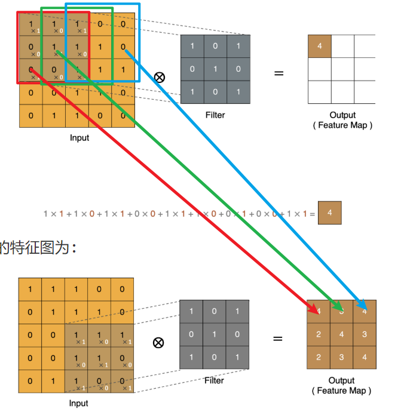

# 05 正则化与 CNN 基础

> **对应课程**：黑马《神经网络与深度学习》Day05–Day06（分P 69–91）
> **覆盖内容**：正则化（L1 / L2 / Dropout / BN）· 手机价格分类案例 · 图像基础知识 · CNN 卷积层 · 池化层
> **整理日期**：2026-10-15

---

## 正则化方法

### 什么是正则化

- 防止模型过拟合(训练集效果好, 测试集效果差), 提高模型泛化能力
- 一种防止过拟合, 提高模型泛化能力的策略
  - L1正则: 需要通过手动写代码实现  
  - L2正则: SGD(weight_decay=)
  - dropout
  - BN

###  Dropout正则化

- 让神经元以p概率随机死亡, 每批次样本训练模型时, 死亡的神经元都是随机, 防止预测结果受某个神经元影响(防止过拟合)

- p概率->[0.2, 0.5], 简单模型概率低, 复杂模型概率高

- 不失活的神经元计算结果除以(1-p), 让训练时输出结果和测试时(dropout不生效)结果一致

  - 训练模型 -> model.train()
  - 测试模型 -> model.eval()

- dropout是在激活层后使用

  ```python
  import torch
  import torch.nn as nn
  
  
  # dropout随机失活: 每批次样本训练时,随机让一部分神经元死亡,防止一些特征对结果影响大(防止过拟合)
  def dm01():
  	# todo:1-创建隐藏层输出结果
  	# float(): 转换成浮点类型张量
  	t1 = torch.randint(low=0, high=10, size=(1, 4)).float()
  	print('t1->', t1)
  	# todo:2-进行下一层加权求和计算
  	linear1 = nn.Linear(in_features=4, out_features=4)
  	l1 = linear1(t1)
  	print('l1->', l1)
  	# todo:3-进行激活值计算
  	output = torch.sigmoid(l1)
  	print('output->', output)
  	# todo:4-对激活值进行dropout处理  训练阶段
  	# p: 失活概率
  	dropout = nn.Dropout(p=0.4)
  	d1 = dropout(output)
  	print('d1->', d1)
  
  
  if __name__ == '__main__':
  	dm01()
  ```

### 批量归一正则化(Batch Normalization)

- 计算每个batch样本的均值和标准差, 利用均值和标准差计算出标准化的值

- 每个batch的均值和标准差都不一样, 会引入噪声样本数据, 降低训练模型效果(防止过拟合)

- 引入两个自学习的γ和β参数, 让每层的样本分布不一样(每层的激活函数可以不一样)

- 加速模型训练效果, 数据分布越均匀, 加权求和结果落入到合理区间(导数最大)

- 训练时进行标准化, 测试时不进行标准化

  ```python
  """
  正则化: 每批样本的均值和方差不一样, 引入噪声样本
  加快模型收敛: 样本标准化后, 落入激活函数的合理区间, 导数尽可能最大
  """
  import torch
  import torch.nn as nn
  
  
  # nn.BatchNorm1d(): 处理一维样本, 每批样本数最少是2个, 否则无法计算均值和标准差
  # nn.BatchNorm2d(): 处理二维样本, 图像(每个通道由二维矩阵组成), 计算二维矩阵每列均值和标准差
  # nn.BatchNorm3d(): 处理三维样本, 视频
  # 处理二维数据
  def dm01():
  	# todo:1-创建图像样本数据集 2个通道,每个通道3*4列特征图, 卷积层处理的特征图样本
  	# 数据集只有一张图像, 图像是由2个通道组成, 每个通道由3*4像素矩阵
  	input_2d = torch.randn(size=(1, 2, 3, 4))
  	print('input_2d->', input_2d)
  	# todo:2-创建BN层, 标准化 ->一定是在激活函数前进行标准化
  	# num_features: 输入样本的通道数
  	# eps: 小常数, 避免除0
  	# momentum: 指数移动加权平均值
  	# affine: 默认True, 引入可学习的γ和β参数
  	bn2d = nn.BatchNorm2d(num_features=2, eps=1e-5, momentum=0.1, affine=True)
  	ouput_2d = bn2d(input_2d)
  	print('ouput_2d->', ouput_2d)
  
  # 处理一维数据
  def dm02():
  	# 创建样本数据集
  	input_1d = torch.randn(size=(2, 2))
  	# 创建线性层
  	linear1 = nn.Linear(in_features=2, out_features=4)
  	l1 = linear1(input_1d)
  	print('l1->', l1)
  	# 创建BN层
  	bn1d = nn.BatchNorm1d(num_features=4)
  	# 对线性层的结果进行标准化处理
  	output_1d = bn1d(l1)
  	print('output_1d->', output_1d)
  
  
  
  if __name__ == '__main__':
  	# dm01()
  	dm02()
  ```

## 手机价格分类案例

### 案例需求

- 分类问题 0,1,2,3 四个类别
- 实现步骤
  - 准备数据集 -> 数据集分割, 转换成张量数据集
  - 构建神经网络模型 -> 继承nn.module
  - 模型训练
  - 模型评估

### 构建张量数据集

```python
# 导入相关模块
import torch
from torch.utils.data import TensorDataset
from torch.utils.data import DataLoader
import torch.nn as nn
from torchsummary import summary
import torch.optim as optim
from sklearn.model_selection import train_test_split
import numpy as np
import pandas as pd
import time


# todo:1-构建数据集
def create_dataset():
    print('===========================构建张量数据集对象===========================')
	# todo:1-1 加载csv文件数据集
	data = pd.read_csv('data/手机价格预测.csv')
	print('data.head()->', data.head())
	print('data.shape->', data.shape)
	# todo:1-2 获取x特征列数据集和y目标列数据集
	# iloc属性 下标取值
	x, y = data.iloc[:, :-1], data.iloc[:, -1]
	# 将特征列转换成浮点类型
	x = x.astype(np.float32)
	print('x->', x.head())
	print('y->', y.head())
	# todo:1-3 数据集分割 8:2
	x_train, x_valid, y_train, y_valid = train_test_split(x, y, train_size=0.8, random_state=88)
	# todo:1-4 数据集转换成张量数据集
	# x_train,y_train类型是df对象, df不能直接转换成张量对象
	# x_train.values():获取df对象的数据值, 得到numpy数组
	# torch.tensor(): numpy数组对象转换成张量对象
	train_dataset = TensorDataset(torch.tensor(data=x_train.values), torch.tensor(data=y_train.values))
	valid_dataset = TensorDataset(torch.tensor(data=x_valid.values), torch.tensor(data=y_valid.values))
	# todo:1-5 返回训练数据集, 测试数据集, 特征数, 类别数
	# shape->(行数, 列数) [1]->元组下标取值
	# np.unique()->去重 len()->去重后的长度 类别数
	print('x.shape[1]->', x.shape[1])
	print('len(np.unique(y)->', len(np.unique(y)))
	return train_dataset, valid_dataset, x.shape[1], len(np.unique(y))


if __name__ == '__main__':
	train_dataset, valid_dataset, input_dim, class_num = create_dataset()
```

### 构建分类神经网络模型

```python
# todo:2-构建神经网络分类模型
class PhonePriceModel(nn.Module):
	print('===========================构建神经网络分类模型===========================')
	# todo:2-1 构建神经网络  __init__()
	def __init__(self, input_dim, output_dim):
		# 继承父类的构造方法
		super().__init__()
		# 第一层隐藏层
		self.linear1 = nn.Linear(in_features=input_dim, out_features=128)
		# 第二层隐藏层
		self.linear2 = nn.Linear(in_features=128, out_features=256)
		# 输出层
		self.output = nn.Linear(in_features=256, out_features=output_dim)
	# todo:2-2 前向传播方法 forward()
	def forward(self, x):
		# 第一层隐藏层计算
		x = torch.relu(input=self.linear1(x))
		# 第二层隐藏层计算
		x = torch.relu(input=self.linear2(x))
		# 输出层计算
		# 没有进行softmax激活计算, 后续创建损失函数时CrossEntropyLoss=softmax+损失计算
		output = self.output(x)
		return output
# todo:3-模型训练
# todo:4-模型评估

if __name__ == '__main__':
	# 创建张量数据集对象
	train_dataset, valid_dataset, input_dim, class_num = create_dataset()
	# 创建模型对象
	model = PhonePriceModel(input_dim=input_dim, output_dim=class_num)
	# 计算模型参数
	# input_size: 输入层样本形状
	summary(model, input_size=(16, input_dim))
```

###  模型训练

```python
# todo:3-模型训练
def train(train_dataset, input_dim, class_num):
	print('===========================模型训练===========================')
	# todo:3-1 创建数据加载器 批量训练
	dataloader = DataLoader(dataset=train_dataset, batch_size=8, shuffle=True)
	# todo:3-2 创建神经网络分类模型对象, 初始化w和b
	model = PhonePriceModel(input_dim=input_dim, output_dim=class_num)
	print("======查看模型参数w和b======")
	for name, parameter in model.named_parameters():
		print(name, parameter)
	# todo:3-3 创建损失函数对象 多分类交叉熵损失=softmax+损失计算
	criterion = nn.CrossEntropyLoss()
	# todo:3-4 创建优化器对象 SGD
	optimizer = optim.SGD(params=model.parameters(), lr=1e-3)
	# todo:3-5 模型训练 min-batch 随机梯度下降
	# 训练轮数
	num_epoch = 50
	for epoch in range(num_epoch):
		# 定义变量统计每次训练的损失值, 训练batch数
		total_loss = 0.0
		batch_num = 0
		# 训练开始的时间
		start = time.time()
		# 批次训练
		for x, y in dataloader:
			# 切换模型模式
			model.train()
			# 模型预测 y预测值
			y_pred = model(x)
			# print('y_pred->', y_pred)
			# 计算损失值
			loss = criterion(y_pred, y)
			# print('loss->', loss)
			# 梯度清零
			optimizer.zero_grad()
			# 计算梯度
			loss.backward()
			# 更新参数 梯度下降法
			optimizer.step()
			# 统计每次训练的所有batch的平均损失值和和batch数
			# item(): 获取标量张量的数值
			total_loss += loss.item()
			batch_num += 1
		# 打印损失变换结果
		print('epoch: %4s loss: %.2f, time: %.2fs' % (epoch + 1, total_loss / batch_num, time.time() - start))
	# todo:3-6 模型保存, 将模型参数保存到字典, 再将字典保存到文件
	torch.save(model.state_dict(), 'model/phone.pth')


if __name__ == '__main__':
	# 创建张量数据集对象
	train_dataset, valid_dataset, input_dim, class_num = create_dataset()
	# 创建模型对象
	# model = PhonePriceModel(input_dim=input_dim, output_dim=class_num)
	# 计算模型参数
	# input_size: 输入层样本形状
	# summary(model, input_size=(16, input_dim))
	# 模型训练
	train(train_dataset=train_dataset, input_dim=input_dim, class_num=class_num)
```

### 模型评估

```python
# todo:4-模型评估
def test(valid_dataset, input_dim, class_num):
	# todo:4-1 创建神经网络分类模型对象
	model = PhonePriceModel(input_dim=input_dim, output_dim=class_num)
	# todo:4-2 加载训练模型的参数字典
	model.load_state_dict(torch.load(f='model/phone.pth'))
	# todo:4-3 创建测试集数据加载器
	# shuffle: 不需要为True, 预测, 不是训练
	dataloader = DataLoader(dataset=valid_dataset, batch_size=8, shuffle=False)
	# todo:4-4 定义变量, 初始值为0, 统计预测正确的样本个数
	correct = 0
	# todo:4-5 按batch进行预测
	for x, y in dataloader:
		print('y->', y)
		# 切换模型模式为预测模式
		model.eval()
		# 模型预测 y预测值 -> 输出层的加权求和值
		output = model(x)
		print('output->', output)
		# 根据加权求和值得到类别, argmax() 获取最大值对应的下标就是类别 y->0,1,2,3
		# dim=1:一行一行处理, 一个样本一个样本
		y_pred = torch.argmax(input=output, dim=1)
		print('y_pred->', y_pred)
		# 统计预测正确的样本个数
		print(y_pred == y)
		# 对布尔值求和, True->1 False->0
		print((y_pred == y).sum())
		correct += (y_pred == y).sum()
		print('correct->', correct)
	# 计算预测精度 准确率
	print('Acc: %.5f' % (correct.item() / len(valid_dataset)))


if __name__ == '__main__':
	# 创建张量数据集对象
	train_dataset, valid_dataset, input_dim, class_num = create_dataset()
	# 创建模型对象
	# model = PhonePriceModel(input_dim=input_dim, output_dim=class_num)
	# 计算模型参数
	# input_size: 输入层样本形状
	# summary(model, input_size=(16, input_dim))
	# 模型训练
	# train(train_dataset=train_dataset, input_dim=input_dim, class_num=class_num)
	# 模型评估
	test(valid_dataset=valid_dataset, input_dim=input_dim, class_num=class_num)
```

### 网络性能优化

- 输入层数据进行标准化
- 神经网络层数增加, 神经元个数增加
- 梯度下降优化方法由SGD调整为Aam
- 学习率由1e-3调整为1e-4
- 正则化
- 增加训练轮数
- ...

##  图像基础知识

### 3.1 图像概念

- 计算机中图像分类表示
  - 二值图像 1通道(1个二维矩阵) 像素值:0或1
  - 灰度图像 1通道 像素值:0-255
  - 索引图像 1通道 索引值->RGB二维矩阵行下标 彩色图像 像素值:0-255
  - RGB真彩色图像(最常用) 3通道(3个二维矩阵) R G B三个二维矩阵 像素值:0-255

###  图像加载

```python
import numpy as np
import matplotlib.pyplot as plt
import torch


# 创建全黑和全白图片
def dm01():
	# 全黑图片
	# 创建3通道二维矩阵, 黑色 0像素点
	# H W C: 200, 200, 3
	# 高 宽 通道
	img1 = np.zeros(shape=(200, 200, 3))
	print('img1->', img1)
	print('img1.shape->', img1.shape)
	# 展示图像
	plt.imshow(img1)
	plt.show()

	# 全白图片
    # 放到全连接层就是 200*200*3=120000个特征值的一维向量
	img2 = torch.full(size=(200, 200, 3), fill_value=255)
	print('img2->', img2)
	print('img2.shape->', img2.shape)
	# 展示图像
	plt.imshow(img2)
	plt.show()


def dm02():
	# 加载图片
	img1 = plt.imread(fname='data/img.jpg')
	print('img1->', img1)
	print('img1.shape->', img1.shape)
	# 保存图像
	plt.imsave(fname='data/img1.png', arr=img1)
	# 展示图像
	plt.imshow(img1)
	plt.show()


if __name__ == '__main__':
	# dm01()
	dm02()
```

## 卷积神经网络(CNN)介绍

### 什么是CNN

- 包含卷积层,池化层以及全连接层的神经网络计算模型
- 组成
  - 卷积层: 提取图像特征图
  - 池化层: 降维, 减少特征图的特征值, 减少模型参数
  - 全连接层: 进行预测, 只能接受二维数据集, 1个样本就是1维向量
    - 将池化层的特征图(1张图像)转换成一维 `200*200*3->120000个特征值`

### CNN应用场景

- 图像分类
- 目标检测
- 面部解锁
- 自动驾驶
- ...

## 卷积层

> 作用: 提取特征图

### 卷积计算

> 卷积计算等同于线性层加权求和计算

- 通过带有权重的卷积核和图像的特征值进行点乘运算, 得到新特征图上的一个特征值

- 卷积核/滤波器 -> 带有权重参数的神经元

- w1x1 + w2x2 + .... + b

  - w1->卷积核一个权重参数
  - x1->特征图的一个特征值(像素点)

  

### Padding(填充)

- 在原图像特征图周围补充特征值(默认补0)
- 作用
  - 使新特征图和原特征图形状保持一致
  - 减少边缘特征值信息丢失问题
    - 未padding, 边缘特征值只参与一次计算, 经过padding后, 边缘特征值参与多次计算
- 实现方式
  - 不进行padding处理: 新特征图比原图像特征图小
  - same padding: 原图像特征图形状和新特征图形状一致
  - full padding: 新特征图形状比原图像特征图大, 新增特征

### Stride(步长)

- stride指卷积核(神经元)在特征图上滑动的步伐 默认1
- 作用:
  - 减少计算量
  - 减少特征, 新特征图特征值减少(降维)
- 一般默认1, 可以设置2或4
- 原图像特征图`5*5`, stride=1->新特征图`3*3`, stride=2->新特征图`2*2`

### 多通道卷积计算

- RGB彩色图像是由3个通道组成 -> 3个二维矩阵, 每个矩阵分别代表R/G/B
- 卷积核通道数和原图像通道数一致
- 卷积计算 -> 对应通道二维矩阵进行卷积计算, 将每个通道卷积计算的结果加到一起, 得到新特征图的一个特征值
- 新特征图是1个二维矩阵, 不是3个二维矩阵

### 多卷积核卷积计算

- 有多少个卷积核就是有多少个神经元, 就会提取到多少个二维的特征图

### 特征图大小计算

- N = (W-F+2P)/S + 1
- N: 新特征图高或宽
- W: 原特征图高或宽
- F: 卷积核高或宽
- P: padding值
- S: stride值
- N如果为小数, 向下取整, 内部封装floor函数

### 卷积层API使用

```python
import torch
import torch.nn as nn
import matplotlib.pyplot as plt

"""
in_channels:原图像的通道数,RGB彩色图像是3
out_channels:卷积核/神经元个数 输出的新图像是由n个通道的二维矩阵组成
kernel_size:卷积核形状 (3,3) (3,5)
stride:步长 默认为1
padding:填充圈数 默认为0  1  same->stride=1  2,3...
nn.Conv2d(in_channels=,out_channels=,kernel_size=,stride=,padding=)
"""


def dm01():
	# todo:1-加载RGB彩色图像 (H,W,C)
	img = plt.imread(fname='data/img.jpg')
	print('img->', img)
	print('img.shape->', img.shape)
	# todo:2-将图像的形状(H,W,C)转换成(C,H,W)  permute()方法
	img2 = torch.tensor(data=img, dtype=torch.float32).permute(dims=(2, 0, 1))
	print('img2->', img2)
	print('img2.shape->', img2.shape)
	# todo:3-将这张图像保存到数据集中 (batch_size,C,H,W)  unsqueeze()方法
	# 数据集只有一个样本
	img3 = img2.unsqueeze(dim=0)
	print('img3->', img3)
	print('img3.shape->', img3.shape)
	# todo:4-创建卷积层对象, 提取特征图
	conv = nn.Conv2d(in_channels=3,
					 out_channels=4,
					 kernel_size=(3, 3),
					 stride=2,
					 padding=0)
	conv_img = conv(img3)
	print('conv_img->', conv_img)
	print('conv_img.shape->', conv_img.shape)

	# 查看提取到的4个特征图
	# 获取数据集中第一张图像
	img4 = conv_img[0]
	# 转换形状 (H,W,C)
	img5 = img4.permute(1, 2, 0)
	print('img5->', img5)
	print('img5.shape->', img5.shape)
	# img5->(H,W,C)
	# img5[:, :, 0]->第1个通道的二维矩阵特征图 第一个特征图
	feature1 = img5[:, :, 0].detach().numpy()
	plt.imshow(feature1)
	plt.show()


if __name__ == '__main__':
	dm01()
```

## 池化层

> 池化层没有神经元参与, 只是实现降维, 不进行特征提取

### 池化计算

- 卷积层提取到的特征图进行降维操作
- 最大池化 -> 二维矩阵中最大的特征作为输出特征
- 平均池化 -> 二维矩阵中平均特征值作为输出特征

###  多通道池化计算

- 池化只在高和宽维度计算, 通道维度不参与池化
- 卷积层提取到的特征图像有多少通道, 经过池化后还是多少通道

### 池化层API使用

```python
import torch
import torch.nn as nn
"""
最大池化
kernel_size:窗口形状大小, 不是神经元形状大小, 池化层没有神经元参与
nn.MaxPool2d(kernel_size=, stride=, padding=)
平均池化
nn.AVGPool2d(kernel_size=, stride=, padding=)
"""

# 单通道卷积层特征图池化
def dm01():
	# 创建1通道的3*3二维矩阵, 一张特征图
	inputs = torch.tensor([[[0, 1, 2], [3, 4, 5], [6, 7, 8]]], dtype=torch.float)
	print('inputs->', inputs)
	print('inputs.shape->', inputs.shape)
	# 创建池化层
	# kernel_size: 窗口的形状大小
	pool1 = nn.MaxPool2d(kernel_size=(2, 2), stride=1, padding=0)
	outputs = pool1(inputs)
	print('outputs->', outputs)
	print('outputs.shape->', outputs.shape)
	pool2 = nn.AvgPool2d(kernel_size=(2, 2), stride=1, padding=0)
	outputs = pool2(inputs)
	print('outputs->', outputs)
	print('outputs.shape->', outputs.shape)


# 多通道卷积层特征图池化
def dm02():
	# size(3,3,3)
	inputs = torch.tensor([[[0, 1, 2], [3, 4, 5], [6, 7, 8]],
						   [[10, 20, 30], [40, 50, 60], [70, 80, 90]],
						   [[11, 22, 33], [44, 55, 66], [77, 88, 99]]], dtype=torch.float)
	# 创建池化层
	# kernel_size: 窗口的形状大小
	pool1 = nn.MaxPool2d(kernel_size=(2, 2), stride=1, padding=0)
	outputs = pool1(inputs)
	print('outputs->', outputs)
	print('outputs.shape->', outputs.shape)
	pool2 = nn.AvgPool2d(kernel_size=(2, 2), stride=1, padding=0)
	outputs = pool2(inputs)
	print('outputs->', outputs)
	print('outputs.shape->', outputs.shape)


if __name__ == '__main__':
	# dm01()
	dm02()
```


---

# 附一 · 课程讲义

> 来源：黑马《神经网络与深度学习》配套讲义，按主题归档到本节。


## 正则化方法

###  什么是正则化


- 在设计机器学习算法时希望在新样本上的泛化能力强。许多机器学习算法都采用相关的策略来减小测试误差，这些策略被统称为正则化
- 神经网络强大的表示能力经常遇到过拟合，所以需要使用不同形式的正则化策略
- 目前在深度学习中使用较多的策略有范数惩罚，DropOut，特殊的网络层等，接下来我们对其进行详细的介绍

###  Dropout正则化

在训练深层神经网络时，由于模型参数较多，在数据量不足的情况下，很容易过拟合。Dropout（中文翻译成随机失活）是一个简单有效的正则化方法。


- 在训练过程中，Dropout的实现是**让神经元以超参数p（丢弃概率）的概率停止工作或者激活被置为0,未被置为0的进行缩放，缩放比例为1/(1-p)**。训练过程可以认为是对完整的神经网络的一些子集进行训练，每次基于输入数据只更新子网络的参数
- 在实际应用中，Dropout参数p的概率通常取值在0.2到0.5之间
  - 对于较小的模型或较复杂的任务，丢弃率可以选择0.3或更小
  - 对于非常深的网络，较大的丢弃率（如0.5或0.6）可能会有效防止过拟合
  - 实际应用中，通常会在全连接层（激活函数后）之后添加Dropout层
- **在测试过程中，随机失活不起作用**
  - 在测试阶段，使用所有的神经元进行预测，以获得更稳定的结果
  - 直接使用训练好的模型进行测试，由于所有的神经元都参与计算，输出的期望值会比训练阶段高。测试阶段的期望输出是 E[x_test] = x
  - 测试/推理模式：==model.eval()==
- **缩放的必要性**
  - 在训练阶段，将参与计算的神经元的输出除以(1-p)
  - 经过Dropout后的期望输出变为 E[x_dropout] = [(1-p) * x] / (1-p) = x，与测试阶段的期望输出一致
  - 训练模型：==model.train()==

我们通过一段代码观察下dropout的效果：

```python
import torch
import torch.nn as nn

def test():
    # 初始化随机失活层
    dropout = nn.Dropout(p=0.4)
    # 初始化输入数据:表示某一层的weight信息
    inputs = torch.randint(0, 10, size=[1, 4]).float()
    layer = nn.Linear(4,5)
    y = layer(inputs)
	y = torch.relu(y)
    print("未失活FC层的输出结果：\n", y)
    y =  dropout(y)
    print("失活后FC层的输出结果：\n", y)
```

**输出结果：**

```python
未失活FC层的输出结果：
 tensor([[0.0000, 1.8033, 1.4608, 4.5189, 6.9116]], grad_fn=<ReluBackward0>)
失活后FC层的输出结果：
 tensor([[0.0000,  3.0055,  2.4346,  7.5315, 11.5193]], grad_fn=<MulBackward0>)
```

上述代码将Dropout层的丢弃概率p设置为0.4，此时经过Dropout层计算的张量中就出现了很多0, 未变为0的按照（1/(1-0.4)）进行处理。

### 批量归一正则化(Batch Normalization)

在神经网络的训练过程中，流经网络的数据都是一个batch，每个batch之间的数据分布变化非常剧烈，==这就使得网络参数频繁的进行大的调整以适应流经网络的不同分布的数据==，给模型训练带来非常大的不稳定性，使得模型难以收敛。**如果我们对每一个batch的数据进行标准化之后，数据分布就变得稳定，参数的梯度变化也变得稳定，有助于加快模型的收敛。**

**通过标准化每一层的输入，使其均值接近0，方差接近1，从而加速训练并提高泛化能力。**


先对数据标准化，再对数据重构（缩放+平移），写成公式如下所示：


λ和β是可学习的参数，它相当于对标准化后的值做了一个**线性变换**，**λ为系数，β为偏置；**

eps 通常指为 1e-5，避免分母为 0；

E(x) 表示变量的均值；

Var(x) 表示变量的方差；


**批量归一化的步骤如下：**


**批量归一化的作用：**

- **减少内部协方差偏移：**通过对每层的输入进行标准化，减少了输入数据分布的变化，从而加速了训练过程，并使得网络在训练过程中更加稳定。

- **加速训练：**
  - 在没有批量归一化的情况下，神经网络的训练通常会很慢，尤其是深度网络。因为在每层的训练过程中，输入数据的分布（特别是前几层）会不断变化，这会导致网络学习速度缓慢。
  - 批量归一化通过确保每层的输入数据在训练时分布稳定，有效减少了这种变化，从而加速了训练过程。

- **起到正则化作用：**批量归一化可以视作一种正则化方法，因为它引入了对训练样本的噪声（不同批次的统计信息不同，批次较小的均值和方差估计会更加不准确），使得模型不容易依赖特定的输入特征，从而起到一定的正则化效果，减少了对其他正则化技术（如Dropout）的需求。

- **提升泛化能力：**由于其正则化效果，批量归一化能帮助网络在测试集上取得更好的性能。


==**批量归一化层在计算机视觉领域使用较多**==

**Batch Normalization 的使用步骤：**

1. **在网络层后添加 BN 层：**
   - 通常，BN 层会添加在卷积层 (Conv2d) 或全连接层 (Linear) 之后，**激活函数之前**。
   - 例如：Conv2d -> BN -> ReLU 或者 Linear -> BN -> ReLU。
2. **训练时：**==model.train()==
   - BN 层会计算当前批次的均值 $$μ$$ 和方差 $$σ²$$。
   - 然后，利用这两个统计量对当前批次的数据进行规范化。
   - 规范化后的数据会被缩放 $$γ$$ 和平移 $$β$$。
   - 同时，BN 层还会维护一个**全局均值**和**全局方差**的移动平均值，用于推理阶段。
3. **推理时：**==model.eval()==
   - 推理时，不会再使用当前批次的均值和方差，而是使用训练阶段计算的**全局均值**和**全局方差**。
   - 同样，规范化后的数据会被缩放 $$γ$$ 和平移 $$β$$。

```python
import torch
import torch.nn as nn

"""
BatchNorm1d：主要应用于全连接层或处理一维数据的网络，例如文本处理。它接收形状为 (N, num_features) 的张量作为输入。
BatchNorm2d：主要应用于卷积神经网络，处理二维图像数据或特征图。它接收形状为 (N, C, H, W) 的张量作为输入。
BatchNorm3d：主要用于三维卷积神经网络 (3D CNN)，处理三维数据，例如视频或医学图像。它接收形状为 (N, C, D, H, W) 的张量作为输入。
"""
    
def tes01():
    # 创建测试样本, 假设是经过卷积层(Conv2d)处理后的特征图
    # (N, C, H, W): 一张图, 两个通道, 每个通道3行4列
    # 可以创建1个样本, 图像的BN是对每个通道的特征图(行列数据)进行标准化
    input_2d = torch.randn(size=(1, 2, 3, 4))
    print("input-->", input_2d)
    # num_features：输入特征数
    # eps：非常小的浮点数，防止除以0的错误
    # momentum：动量系数
    # affine：默认为True，γ和β被使用，让BN层更加灵活
    bn2d = nn.BatchNorm2d(num_features=2, eps=1e-05, momentum=0.1, affine=True) 
    output = bn2d(input_2d)
    print("output-->", output)
    print(output.size())

    print(bn2d.weight)
    print(bn2d.bias)  

def tes02():
    # 创建测试样本
    # 2个样本, 1个特征
    # 不能创建1个样本, 无法统计均值和方差
    input_1d = torch.randn(size=(2, 2)) 
    # 创建线性层对象
    linear1 = nn.Linear(in_features=2, out_features=3)
    # 创建BN层对象
    # num_features：输入特征数
	bn1d = nn.BatchNorm1d(num_features=3)  # 20 output features
	output_1d = linear1(input_1d)
    # 进行批量归一化
	output = bn1d(output_1d) 
    print("output-->", output)
    print(output.size()) # (32, 20)
```

**输出结果：**

```python
test01:
input_2d--> tensor([[[[-0.2751, -1.2183, -0.5106, -0.1540],
          [-0.4585, -0.5989, -0.6063,  0.5986],
          [-0.4745,  0.1496, -1.1266, -1.2377]],

         [[ 0.2580,  1.2065,  1.4598,  0.8387],
          [-0.4586,  0.8938, -0.3328,  0.1192],
          [-0.3265, -0.6263,  0.0419, -1.2231]]]])
output--> tensor([[[[ 0.4164, -1.3889, -0.0343,  0.6484],
          [ 0.0655, -0.2032, -0.2175,  2.0889],
          [ 0.0349,  1.2294, -1.2134, -1.4262]],

         [[ 0.1340,  1.3582,  1.6853,  0.8835],
          [-0.7910,  0.9546, -0.6287, -0.0452],
          [-0.6205, -1.0075, -0.1449, -1.7779]]]],
       grad_fn=<NativeBatchNormBackward0>)
torch.Size([1, 2, 3, 4])
Parameter containing:
tensor([1., 1.], requires_grad=True)
Parameter containing:
tensor([0., 0.], requires_grad=True)

test02:
output--> tensor([[-0.9998,  1.0000,  1.0000],
        [ 0.9998, -1.0000, -1.0000]], grad_fn=<NativeBatchNormBackward0>)
torch.Size([2, 3])
```


## 手机价格分类案例

### 案例需求分析

小明创办了一家手机公司，他不知道如何估算手机产品的价格。为了解决这个问题，他收集了多家公司的手机销售数据。该数据为二手手机的各个性能的数据，最后根据这些性能得到4个价格区间，作为这些二手手机售出的价格区间。主要包括：


我们需要帮助小明找出手机的功能（例如：RAM等）与其售价之间的某种关系。我们可以使用机器学习的方法来解决这个问题，也可以构建一个全连接的网络。
需要注意的是: 在这个问题中，我们不需要预测实际价格，而是一个价格范围，它的范围使用 0、1、2、3 来表示，所以该问题也是一个分类问题。接下来我们还是按照四个步骤来完成这个任务：

- 准备训练集数据
- 构建要使用的模型
- 模型训练
- 模型预测评估

### 构建数据集

数据共有 2000 条, 其中 1600 条数据作为训练集, 400 条数据用作测试集。 我们使用 sklearn 的数据集划分工作来完成。并使用 PyTorch 的 TensorDataset 来将数据集构建为 Dataset 对象，方便构造数据集加载对象。

```python
# 导入相关模块
import torch
from torch.utils.data import TensorDataset
from torch.utils.data import DataLoader
import torch.nn as nn
from torchsummary import summary
import torch.optim as optim
from sklearn.model_selection import train_test_split
import numpy as np
import pandas as pd
import time

# 构建数据集
def create_dataset():
    # 使用pandas读取数据
    data = pd.read_csv('data/手机价格预测.csv')
    # 特征值和目标值
    x, y = data.iloc[:, :-1], data.iloc[:, -1]
    # 类型转换：特征值
    x = x.astype(np.float32)
    # 数据集划分
    x_train, x_valid, y_train, y_valid = train_test_split(x, y, train_size=0.8, random_state=88)
    # 构建数据集,转换为pytorch的形式
    train_dataset = TensorDataset(torch.from_numpy(x_train.values), torch.tensor(y_train.values))
    valid_dataset = TensorDataset(torch.from_numpy(x_valid.values), torch.tensor(y_valid.values))
    # 返回结果
    # x_train.shape[1]: 特征数
    # len(np.unique(y)): 类别数
    return train_dataset, valid_dataset, x_train.shape[1], len(np.unique(y))


if __name__ == '__main__':
    # 获取数据
    train_dataset, valid_dataset, input_dim, class_num = create_dataset()
    print("输入特征数：", input_dim)
    print("分类个数：", class_num)
```

输出结果为：

```python
输入特征数： 20 
分类个数： 4
```

### 构建分类网络模型

构建全连接神经网络来进行手机价格分类，该网络主要由三个线性层来构建，使用relu激活函数。
网络共有 3 个全连接层, 具体信息如下:
第一层: 输入为维度为 20, 输出维度为: 128
第二层: 输入为维度为 128, 输出维度为: 256
第三层: 输入为维度为 256, 输出维度为: 4

```python
# 构建网络模型
class PhonePriceModel(nn.Module):
	def __init__(self, input_dim, output_dim):
		super(PhonePriceModel, self).__init__()
		# 1. 第一层: 输入为维度为 20, 输出维度为: 128
		self.linear1 = nn.Linear(input_dim, 128)
		# 2. 第二层: 输入为维度为 128, 输出维度为: 256
		self.linear2 = nn.Linear(128, 256)
		# 3. 第三层: 输入为维度为 256, 输出维度为: 4
		self.linear3 = nn.Linear(256, output_dim)

	def forward(self, x):
		# 前向传播过程
		x = torch.relu(self.linear1(x))
		x = torch.relu(self.linear2(x))
        # 后续CrossEntropyLoss损失函数中包含softmax过程, 所以当前步骤不进行softmax操作
		output = self.linear3(x)
		# 获取数据结果
		return output
        
        
if __name__ == '__main__':
    train_dataset, valid_dataset, input_dim, class_num = create_dataset()
    # 模型实例化
    model = PhonePriceModel(input_dim, class_num)
    summary(model, input_size=(input_dim,), batch_size=16)
```


### 模型训练

网络编写完成之后，我们需要编写训练函数。所谓的训练函数，指的是输入数据读取、送入网络、计算损失、更新参数的流程，该流程较为固定。我们使用的是多分类交叉生损失函数、使用 SGD 优化方法。最终，将训练好的模型持久化到磁盘中。

```python
# 模型训练过程
def train(train_dataset,input_dim,class_num):
    # 固定随机数种子
    torch.manual_seed(0)
    # 初始化数据加载器
    dataloader = DataLoader(train_dataset, shuffle=True, batch_size=8)
    # 初始化模型
    model = PhonePriceModel(input_dim, class_num)
    # 损失函数  CrossEntropyLoss = softmax + 损失计算
    criterion = nn.CrossEntropyLoss()
    # 优化方法
    optimizer = optim.SGD(model.parameters(), lr=1e-3)
    # 训练轮数
    num_epoch = 50
    # 遍历每个轮次的数据
    for epoch_idx in range(num_epoch):
        # 训练时间
        start = time.time()
        # 计算损失
        total_loss = 0.0
        total_num = 0
        # 遍历每个batch数据进行处理
        for x, y in dataloader:
            # 将数据送入网络中进行预测
            model.train() # 使用训练模式
            output = model(x)
            # 计算损失
            loss = criterion(output, y)
            # 梯度清零
            optimizer.zero_grad()
            # 反向传播
            loss.backward()
            # 参数更新
            optimizer.step()
            # 损失计算
            total_num += 1
            total_loss += loss.item()
        # 打印损失变换结果
        print('epoch: %4s loss: %.2f, time: %.2fs' %(epoch_idx + 1, total_loss / total_num, time.time() - start))
    # 模型保存
    # state_dict(): 将模型的参数保存到字典中
    torch.save(model.state_dict(), 'model/phone-price-model.pth')
    

if __name__ == '__main__':    
    # 获取数据
    train_dataset, valid_dataset, input_dim, class_num = create_dataset()
    # 模型训练过程
    train(train_dataset,input_dim,class_num)
```


### 模型评估

使用训练好的模型，对未知的样本的进行预测的过程。我们这里使用前面单独划分出来的验证集来进行评估。

```python
def test(valid_dataset, input_dim, class_num):
    # 加载模型和训练好的网络参数
    model = PhonePriceModel(input_dim, class_num)
    # load_state_dict:将加载的参数字典应用到模型上
	# load:加载用来保存模型参数的文件
    model.load_state_dict(torch.load('model/phone-price-model.pth'))
    # 构建加载器
    dataloader = DataLoader(valid_dataset, batch_size=8, shuffle=False)
    # 评估测试集
    correct = 0
    # 遍历测试集中的数据
    for x, y in dataloader:
        # 将其送入网络中
        model.eval() # 使用推理模式 
        output = model(x)
        # 获取类别结果
        # argmax: 最大值对应的下标, 即类别编码
        y_pred = torch.argmax(output, dim=1)
        # 获取预测正确的个数
        correct += (y_pred == y).sum()
    # 求预测精度
    print('Acc: %.5f' % (correct.item() / len(valid_dataset)))
        
        
if __name__ == '__main__':
    # 获取数据
    train_dataset, valid_dataset, input_dim, class_num = create_dataset()
    # 模型预测结果
    test(valid_dataset, input_dim, class_num)
```

**输出结果：**

```python
Acc: 0.64250
```

###  网络性能优化

我们前面的网络模型在测试集的准确率为: 0.64250, 我们可以通过以下方面进行调优:

1. 对输入数据进行标准化
2. 调整优化方法
3. 调整学习率
4. 增加批量归一化层
5. 增加网络层数、神经元个数
6. 增加训练轮数
7. 等等...

进行下如下调整:

1. 优化方法由 SGD 调整为 Adam
2. 学习率由 1e-3 调整为 1e-4
3. 对数据进行标准化
4. 增加网络深度, 即: 增加网络参数量

```python
import torch
import torch.nn as nn
import pandas as pd
from sklearn.model_selection import train_test_split
from torch.utils.data import TensorDataset
from torch.utils.data import DataLoader
import torch.optim as optim
import numpy as np
import time
from sklearn.preprocessing import StandardScaler


# 构建数据集
def create_dataset():
	# 使用pandas读取数据
	data = pd.read_csv('./data/手机价格预测.csv')
	# 特征值和目标值
	x, y = data.iloc[:, :-1], data.iloc[:, -1]
	# 类型转换：特征值，目标值
	x = x.astype(np.float32)
	y = y.astype(np.int64)
	# 数据集划分
	x_train, x_valid, y_train, y_valid = train_test_split(x, y, train_size=0.8, random_state=88, stratify=y)
	# 优化①:数据标准化
	transfer = StandardScaler()
	x_train = transfer.fit_transform(x_train)
	x_valid = transfer.transform(x_valid)
	# 构建数据集,转换为pytorch的形式
	train_dataset = TensorDataset(torch.from_numpy(x_train), torch.tensor(y_train.values))
	valid_dataset = TensorDataset(torch.from_numpy(x_valid), torch.tensor(y_valid.values))
	# 返回结果
	return train_dataset, valid_dataset, x_train.shape[1], len(np.unique(y))


# 构建网络模型
class PhonePriceModel(nn.Module):

	def __init__(self, input_dim, output_dim):
		super(PhonePriceModel, self).__init__()
		# 优化②:增加网络深度
		# 1. 第一层: 输入为维度为 20, 输出维度为: 128
		self.linear1 = nn.Linear(input_dim, 128)
		# 2. 第二层: 输入为维度为 128, 输出维度为: 256
		self.linear2 = nn.Linear(128, 256)
		# 3. 第三层: 输入为维度为 256, 输出维度为: 512
		self.linear3 = nn.Linear(256, 512)
		# 4. 第四层: 输入为维度为 512, 输出维度为: 128
		self.linear4 = nn.Linear(512, 128)
		# 5. 输出层: 输入为维度为 128, 输出维度为: 4
		self.linear5 = nn.Linear(128, output_dim)

	def forward(self, x):
		# 前向传播过程
		x = torch.relu(self.linear1(x))
		x = torch.relu(self.linear2(x))
		x = torch.relu(self.linear3(x))
		x = torch.relu(self.linear4(x))
		# 后续CrossEntropyLoss损失函数中包含softmax过程, 所以当前步骤不进行softmax操作
		output = self.linear5(x)
		# 获取数据结果
		return output


# 编写训练函数
def train(train_dataset, input_dim, class_num):
	# 固定随机数种子
	torch.manual_seed(0)
	# 初始化数据加载器
	dataloader = DataLoader(train_dataset, shuffle=True, batch_size=8)
	# 初始化模型
	model = PhonePriceModel(input_dim, class_num)
	# 损失函数 CrossEntropyLoss = softmax + 损失计算
	criterion = nn.CrossEntropyLoss()
	# 优化③:使用Adam优化方法, 优化④:学习率变为1e-4
	optimizer = optim.Adam(model.parameters(), lr=1e-4)
	# 遍历每个轮次的数据
	num_epoch = 50
	for epoch_idx in range(num_epoch):
		# 训练时间
		start = time.time()
		# 计算损失
		total_loss = 0.0
		total_num = 0
		# 遍历每个batch数据进行处理
		for x, y in dataloader:
			model.train()
			output = model(x)
			# 计算损失
			loss = criterion(output, y)
			# 梯度清零
			optimizer.zero_grad()
			# 反向传播
			loss.backward()
			# 参数更新
			optimizer.step()
			# 损失计算
			total_num += len(y)
			total_loss += loss.item() * len(y)
		# 打印损失变换结果
		print('epoch: %4s loss: %.2f, time: %.2fs' %
			  (epoch_idx + 1, total_loss / total_num, time.time() - start))
	# 模型保存
	torch.save(model.state_dict(), './model/phone-price-model2.pth')


def test(valid_dataset, input_dim, class_num):
	# 加载模型和训练好的网络参数
	model = PhonePriceModel(input_dim, class_num)
	# load_state_dict:将加载的参数字典应用到模型上
	# load:加载用来保存模型参数的文件
	model.load_state_dict(torch.load('./model/phone-price-model2.pth'))
	# 构建加载器
	dataloader = DataLoader(valid_dataset, batch_size=8, shuffle=False)
	# 评估测试集
	correct = 0
	# 遍历测试集中的数据
	for x, y in dataloader:
		# 将其送入网络中
		# model.eval()
		output = model(x)
		# 获取预测类别结果
		y_pred = torch.argmax(output, dim=1)
		# 获取预测正确的个数
		correct += (y_pred == y).sum()
	# 求预测精度
	print('Acc: %.5f' % (correct / len(valid_dataset)))


if __name__ == '__main__':
	train_dataset, valid_dataset, input_dim, class_num = create_dataset()
	train(train_dataset, input_dim, class_num)
	test(valid_dataset, input_dim, class_num)
```


## 图像基础知识

###  图像基本概念

图像是人类视觉的基础，是自然景物的客观反映，是人类**认识世界和人类本身**的重要源泉。**“图”是物体反射或透射光的分布，“像“是人的视觉系统所接受的图在人脑中所形成的印象或认识**，[照片](https://baike.baidu.com/item/%E7%85%A7%E7%89%87/1465692?fromModule=lemma_inlink)、绘画、剪贴画、地图、书法作品、手写汉字、传真、卫星云图、影视画面、X光片、脑电图、[心电图](https://baike.baidu.com/item/%E5%BF%83%E7%94%B5%E5%9B%BE/399200?fromModule=lemma_inlink)等都是图像。

在计算机中，按照颜色和灰度的多少可以将图像分为四种基本类型。

- **二值图像**

  一幅二值图像的二维[矩阵](https://so.csdn.net/so/search?q=%E7%9F%A9%E9%98%B5&spm=1001.2101.3001.7020)仅由0、1两个值构成，**“0”代表黑色，“1”代白色**。由于每一像素（矩阵中每一元素）取值仅有0、1两种可能，所以计算机中二值图像的数据类型通常为1个二进制位。二值图像通常用于文字、线条图的扫描识别（OCR）和掩膜图像的存储。

  

- **灰度图像**

  **灰度图像矩阵元素的取值范围通常为[0，255]**。因此其数据类型一般为**8位无符号整数的（int8）**，这就是人们经常提到的256灰度图像。**“0”表示纯黑色，“255”表示纯白色，中间的数字从小到大表示由黑到白的过渡色。**二值图像可以看成是灰度图像的一个特例。

- **索引图像**

  索引图像的文件结构比较复杂，除了**存放图像的二维矩阵**外，还包括一个称之为**颜色索引矩阵MAP的二维数组**。MAP的大小由存放图像的矩阵元素值域决定，如矩阵元素值域为[0，255]，则MAP矩阵的大小为256Ⅹ3，**用MAP=[RGB]表示**。**MAP中每一行的三个元素分别指定该行对应颜色的红、绿、蓝单色值，MAP中每一行对应图像矩阵像素的一个灰度值**，如某一像素的灰度值为64，则该像素就与MAP中的第64行建立了映射关系，该像素在屏幕上的实际颜色由第64行的[RGB]组合决定。也就是说，图像在屏幕上显示时，每一像素的颜色由存放在矩阵中该像素的灰度值作为索引通过检索颜色索引矩阵MAP得到。

  

- **真彩色RGB图像**

  RGB图像与索引图像一样都可以用来表示彩色图像。与索引图像一样，它分别用红（R）、绿（G）、蓝（B）三原色的组合来表示每个像素的颜色。但与索引图像不同的是，**RGB图像每一个像素的颜色值（由RGB三原色表示）直接存放在图像矩阵中**，由于每一像素的颜色需由R、G、B三个分量来表示，**M、N分别表示图像的行列数，三个M x N的二维矩阵分别表示各个像素的R、G、B三个颜色分量。**RGB图像的数据类型一般为8位无符号整形。**注意：通道的顺序是 BGR 而不是 RGB。**

  

  | 图像类型     | 通道数           | 像素值范围       | 主要特点                                 | 常见用途                         |
  | ------------ | ---------------- | ---------------- | ---------------------------------------- | -------------------------------- |
  | **二值图像** | 1通道            | 0 或 1           | 每个像素只有黑与白两种值                 | 形态学操作、二值化、轮廓检测     |
  | **灰度图像** | 1通道            | 0 到 255         | 每个像素表示灰度（亮度）                 | 图像预处理、物体检测、人脸识别   |
  | **索引图像** | 1通道            | 0 到 255（索引） | 像素值为颜色表的索引，颜色表决定实际颜色 | 存储压缩、较少颜色的图像表示     |
  | **RGB图像**  | 3通道（R、G、B） | 0 到 255         | 每个像素由红、绿、蓝三个通道组成         | 普通彩色图像显示、图像处理与分析 |

  简单的讲：**图像是由像素点组成的，每个像素点的取值范围为: [0, 255] 。像素值越接近于0，颜色越暗，接近于黑色；像素值越接近于255，颜色越亮，接近于白色。**

  在深度学习中，我们使用的图像大多是彩色图，彩色图由RGB3个通道组成，如下图所示：

  

###  图像加载

使用 matplotlib 库来实际理解下上面讲解的图像知识。

```python
import numpy as np
import matplotlib.pyplot as plt


# 像素值的理解
def test01():
    # 全0数组是黑色的图像
    # H, W, C -> 高, 宽, 通道
    img = np.zeros(shape=[200, 200, 3])
    # 展示图像
    plt.imshow(img)
    # 对坐标轴进行设置
    # off:关闭坐标轴
    plt.axis("off")
    plt.show()

    # 全255数组是白色的图像
    img = np.full(shape=[200, 200, 3], fill_value=255)
    # 展示图像
    plt.imshow(img)
    plt.show()


# 图像的加载
def test02():
    # 读取图像
    img = plt.imread("data/img.jpg")
    # 保存图像
    plt.imsave("data/img1.jpg", img)
    # 打印图像形状 高,宽,通道
    print("图像的形状(H, W, C):\n", img.shape)
    # 展示图像
    plt.imshow(img)
    plt.axis("off")
    plt.show()


if __name__ == '__main__':
    test01()
    test02()
```

**输出结果:**

全黑和全白图像：


图像的形状为：

```python
图像的形状（H，W，C）:
 (640, 640, 3)
```


## 卷积神经网络（CNN）概述

###  什么是卷积神经网络

**卷积神经网络是深度学习在计算机视觉领域的突破性成果，专门用于处理图像、视频、语音等数据的神经网络** 

在计算机视觉领域, 往往我们输入的图像都很大，使用全连接网络的话，计算的代价较高。另外图像也很难保留原有的特征，导致图像处理的准确率不高。

卷积神经网络（Convolutional Neural Network）是**含有卷积层的神经网络**。卷积层的**作用就是用来自动学习、提取图像的特征**。

CNN网络主要由三部分构成：**卷积层、池化层和全连接层**构成：

（1）卷积层负责提取图像中的局部特征

（2）池化层用来大幅降低参数量级(降维)

（3）全连接层类似人工神经网络的部分，用来输出想要的结果


上图中CNN要做的事情是：给定一张图片，是车还是马未知，是什么车也未知，现在需要模型判断这张图片里具体是一个什么东西，总之输出一个结果：如果是车，那是什么车

- 最左边是
  - 数据输入层：对数据做一些处理，比如去均值（各维度都减对应维度的均值，使得输入数据各个维度都中心化为0，避免数据过多偏差，影响训练效果）、归一化（把所有的数据都归一到同样的范围）、PCA等等。CNN只对训练集做“去均值”这一步。
- 中间是
  - 卷积层(CONV)：线性乘积求和，提取图像中的局部特征
  - 激励层(RELU)：ReLU激活函数,输入数据转换成输出数据
  - 池化层(POOL)：取区域平均值或最大值，大幅降低参数量级(降维)
- 最右边是
  - 全连接层(FC)：接收二维数据集，输出CNN模型预测结果

### 卷积神经网络应用

**图像分类**：最常见的应用，例如识别图片中的物体类别

**目标检测**：检测图像中物体的位置和类别

**图像分割**：将图像分成多个区域，用于语义分割

**人脸识别**：识别图像中的人脸

**医学图像分析**：用于检测医学图像中的异常（如癌症检测、骨折检测等）

**自动驾驶**：用于识别交通标志、车辆、行人

###  **CNN中的经典算法/网络架构**

**LeNet-5:**作为最早的CNN架构之一，证明了CNN在图像识别任务上的有效性，为后续的CNN发展奠定了基础

- **卷积层:** 提取图像的边缘、角点等基本特征
- **池化层 (子采样层):** 降低特征图的维度，减少计算量，并提高模型对输入图像微小变化的鲁棒性
- **全连接层:** 将卷积层和池化层提取的特征进行组合，用于最终的分类

**AlexNet:**显著提升了ImageNet图像分类的准确率，证明了深度学习在计算机视觉领域的潜力，并推动了深度学习的快速发展

- **卷积层:** 使用更大的卷积核和更多的卷积核，提取更丰富的图像特征
- **ReLU激活函数:** 加速训练过程，并提高模型的性能
- **最大池化层:** 降低特征图的维度
- **Dropout层:** 防止过拟合
- **全连接层:** 用于最终的分类

**VGGNet:**探索了网络深度对性能的影响，证明了更深的网络可以提取更抽象和更具表达力的特征

- **卷积层:** 使用更小的卷积核 (3x3)，并堆叠多个卷积层，增加了网络的深度，提取更复杂的特征
- **最大池化层:** 降低特征图的维度
- **全连接层:** 用于最终的分类

**GoogLeNet (Inception):**提出了 Inception 模块，在提高性能的同时减少了计算量，为后续的网络架构设计提供了新的思路

- **Inception 模块:** 并行使用不同大小的卷积核和池化操作，然后将它们的输出连接起来，增加了网络的宽度，提高了网络的效率

**ResNet:**解决了深度网络训练困难的问题，使得可以训练更深的网络，从而显著提高了模型的性能

- **残差块 (Residual Block):** 引入跳跃连接 (Shortcut Connection)，允许梯度直接反向传播到浅层，解决了深度网络的梯度消失问题，使得训练非常深的网络成为可能

**DenseNet:**

- **密集块 (Dense Block):** 将每一层都与之前的所有层连接，特征重用更加充分，进一步提高了网络的性能和参数效率
- DenseNet通过密集连接（Dense Connectivity）在网络中各层之间建立了直接的连接，即每一层都接收前面所有层的输出作为输入。这种设计增强了特征传递和梯度流动，避免了梯度消失问题，并提高了信息的利用率


## 卷积层

> 卷积层（Convolutional Layer）通过卷积操作提取输入数据中的特征（例如图像中的边缘、纹理、形状等）。
>
> 卷积层利用卷积核（滤波器）对输入进行处理，从而生成特征图（feature map），并且每个卷积层能够提取不同层次的特征，从低级特征（如边缘）到高级特征（如物体的形状）。
>
> **卷积层的主要作用如下：**
>
> - **特征提取**：卷积层的主要作用是从输入图像中提取低级特征（如边缘、角点、纹理等）。通过多个卷积层的堆叠，网络能够逐渐从低级特征到高级特征（如物体的形状、区域等）进行学习。
>
> - **权重共享**：在卷积层中，同一个卷积核在整个输入图像上共享权重，这使得卷积层的参数数量大大减少，减少了计算量并提高了训练效率。
>
> - **局部连接**：卷积层中的每个神经元仅与输入图像的一个小局部区域相连，这称为**局部感受野**，这种局部连接方式更符合图像的空间结构，有助于捕捉图像中的局部特征。
>
> - **空间不变性**：由于卷积操作是局部的并且采用权重共享，卷积层在处理图像时具有**平移不变性**。也就是说，不论物体出现在图像的哪个位置，卷积层都能有效地检测到这些物体的特征。

### 卷积计算


1. input 表示输入的图像

2. filter 表示卷积核, 也叫做滤波器(滤波矩阵)

   - 一组固定的权重，因为每个神经元的多个权重固定，所以又可以看做一个恒定的滤波器filter
   - 非严格意义上来讲，下图中红框框起来的部分便可以理解为一个滤波器，即带着**一组固定权重的神经元**。多个滤波器叠加便成了卷积层
   - 一个卷积核就是一个神经元

   

3. input 经过 filter 得到输出为最右侧的图像，该图叫做特征图

那么, 它是如何进行计算的呢？**卷积运算本质上就是在滤波器和输入数据的局部区域间做点积。**


左上角的点计算方法：


按照上面的计算方法可以得到最终的特征图为:


图像上的卷积:

在下图对应的计算过程中，输入是一定区域大小(width*height)的数据，和滤波器filter（带着一组固定权重的神经元）做内积后得到新的二维数据。


具体来说，左边是图像输入，中间部分就是滤波器filter（带着一组固定权重的神经元），不同的滤波器filter会得到不同的输出数据，比如颜色深浅、轮廓。相当于如果想提取图像的不同特征，则用不同的滤波器filter，提取想要的关于图像的特定信息：颜色深浅或轮廓。

### Padding（填充）

通过上面的卷积计算过程，最终的特征图比原始图像小很多，如果想要保持经过卷积后的图像大小不变, 可以在**原图周围**添加 Padding 来实现。

Padding（填充）操作是一种用于==在输入特征图的边界周围添加额外像素（通常是零）==。

**Padding的主要作用：**

- **保持空间维度：**如果不使用 padding，每次卷积操作后，特征图的尺寸都会缩小。多次卷积后，特征图会变得非常小，可能会丢失重要的边缘信息。Padding可以帮助维持输出特征图的尺寸与输入相同或接近相同。
- **保留边缘信息：**图像边缘的像素在卷积过程中参与的计算次数较少，这意味着边缘信息在特征提取过程中容易丢失。Padding通过在边缘添加额外的像素，增加了边缘像素的参与度，从而更好地保留了边缘信息。
- **提高性能：**Padding有助于避免由于特征图尺寸快速缩小而导致的信息丢失，从而提高模型的性能，尤其是在处理较小的图像或需要进行多层卷积时。

**Padding的类型：**

- **Valid Padding (No Padding):** 不进行任何填充。卷积核只在输入图像的有效区域内滑动。输出尺寸会缩小。 
- **Same Padding:** 添加足够的填充，使得输出特征图的尺寸与输入相同。 
- **Full Padding:** 尽可能多地添加填充，使得卷积核的每个元素都至少在输入图像上滑动一次。输出尺寸会增大。

**Padding的选择：**取决于具体的应用场景和网络架构

- **Valid Padding:** 适用于不需要保持输出尺寸的场景，或者输入图像足够大，边缘信息丢失不重要的情况。
- **Same Padding:** 广泛应用于各种CNN架构中，因为它可以保持特征图的尺寸，方便网络设计和计算。
- **Full Padding:** 较少使用，因为它会增加计算量，并且可能会在边缘引入一些伪影。


### Stride（步长）

Stride（步长）指的是**卷积核在图像上滑动时的步伐大小**，即每次卷积时卷积核在图像中向右（或向下）移动的像素数。步长直接影响卷积操作后输出特征图的尺寸，以及计算量和模型的特征提取能力。

**Stride的作用:**

- **降低计算复杂度：**更大的步长意味着卷积核移动的次数更少，从而减少了计算量，并加快了训练和推理速度。
- **减1长越大，生成的特征图尺寸越小。这类似于池化的降维效果。
- **增大感受野：**虽然更大的步长会减小特征图的尺寸，但它同时也会增大每个神经元在输入数据上的感受野。这意味着每个神经元能够捕捉到更大范围的输入信息。

**Stride的选择：**取决于具体的应用场景和网络架构

- **Stride = 1:** 这是最常见的设置，尤其是在网络的早期层。它允许保留更多的空间细节。
- **Stride > 1:** 通常用于减小特征图的尺寸和增大感受野，例如在网络的后期层或需要进行快速降维时。 常见的设置包括 stride=2 或 stride=4。

按照步长为1来移动卷积核，计算特征图如下所示：


如果把Stride增大为2，也是可以提取特征图的，如下图所示：


###  多通道卷积计算

实际中的图像都是多个通道组成的，我们怎么计算卷积呢？


计算方法如下：

1. 当输入有多个通道(Channel), 例如 RGB 三个通道, 此时要求卷积核需要拥有相同的通道数（图像有多少通道，每个卷积核就有多少通道）.
2. 每个卷积核通道与对应的输入图像的各个通道进行卷积.
3. 将每个通道的卷积结果按位相加得到最终的特征图.

如下图所示:


### 多卷积核卷积计算

上面的例子里我们只使用一个卷积核进行特征提取, 实际对图像进行特征提取时, 我们需要使用多个卷积核进行特征提取. 这个多个卷积核可以理解为从不同到的视角、不同的角度对图像特征进行提取.

那么, 当使用多个卷积核时, 应该怎么进行特征提取呢?


通过以下例子查看多卷积核卷积计算流程:


可以看到：

- 两个神经元，意味着有两个滤波器
- 数据窗口每次移动两个步长取3*3的局部数据，即stride=2
- zero-padding=1。输入数据由`5*5*3`变为`7*7*3`
- 左边是输入（**7\*7\*3**中，7*7代表图像的像素/长宽，3代表R、G、B 三个颜色通道）
- 中间部分是两个不同的滤波器Filter w0、Filter w1
- 最右边则是两个不同的输出

### 特征图大小

输出特征图的大小与以下参数息息相关:

1. size: 卷积核/过滤器大小，一般会选择为奇数，比如有 `1*1`, `3*3`， `5*5`
2. Padding: 零填充的方式 
3. Stride: 步长

那计算方法如下图所示:

1. 输入图像大小: W x W
2. 卷积核大小: F x F
3. Stride: S
4. Padding: P
5. 输出图像大小: N x N


以下图为例:

1. 图像大小: 5 x 5
2. 卷积核大小: 3 x 3
3. Stride: 1
4. Padding: 1
5. (5 - 3 + 2) / 1 + 1 = 5（如果除不尽向下取整）, 即得到的特征图大小为: 5 x 5


###  PyTorch卷积层API

在PyTorch中进行卷积的API是：

```python
conv = nn.Conv2d(in_channels, out_channels, kernel_size, stride, padding)

"""
参数说明：
in_channels: 输入通道数，RGB图片一般是3
out_channels: 输出通道，也可以理解为卷积核kernel的数量
kernel_size：卷积核的高和宽设置，一般为3,5,7...
stride：卷积核移动的步长
	整数stride：表示在所有维度上使用相同的步长 stride=2 表示在水平和垂直方向上每次移动2个像素
	元组stride: 允许在不同维度上设置不同的步长 stride=(2, 1) 表示在水平方向上步长为2，在垂直方向上步长为1
padding：在四周加入padding的数量，默认补0
	padding=0：不进行填充。
	padding=1：在每个维度上填充 1 个像素（常用于保持输出尺寸与输入相同 padding=输入形状大小-输出形状大小）。
	padding='same'（从 PyTorch 1.9+ 开始支持）：让输出特征图的尺寸与输入保持一致。PyTorch会自动计算需要的填充量。stride必须等于1，不支持跨行，因为计算padding时可能出现小数
	padding=kernel_size-1：Full Padding 完全填充
"""
```

我们接下来对下面的图片进行特征提取:


下面演示多通道多卷积核卷积:

```python
import torch
import torch.nn as nn
import matplotlib.pyplot as plt

# 对图像进行卷积
# 1 读取图像 显示图像
# 2 定义卷积层
# 3 变换数据形状 1-转成tensor 2-通道要求[C H W] 3-批次数要求 [batch, C, H, W]
# 4 给卷积层喂数据 [1, 3, 640, 640] ---> [1, 4, 319, 319])
# (H-F+2p)/s +1 = (640-3+0)/2 + 1 = 319.5向下取整319
def test01():

    # 1 读取图像
    img = plt.imread('./data/img.jpg')
    print('img.shape', img.shape)

    plt.imshow(img)
    plt.show()

    # 2 定义卷积层
    myconv2d = nn.Conv2d(in_channels=3, out_channels=4, kernel_size=3, stride=2, padding=0)
    print('myconv2d--->', myconv2d)

    # 3 变换数据形状 
	# ①转换成tensor
    # ②通道要求[C, H, W], 默认[H, W, C]
    # ③批次数要求[batch, C, H, W],多少个图像(一个图像是三维数组,四维有多少个三维就是多少个图像)
    # [0, 1, 2] --> [2, 0, 1]
    img2 = torch.tensor(img).permute(2, 0, 1)
    print('img2.shape--->', img2.shape)
	# 图像数为1,变为4维张量
    img3 = img2.unsqueeze(0)
    print('img3.shape--->', img3.shape)

    # 4 给卷积层喂数据 [1, 3, 640, 640] ---> [1, 4, 319, 319])
    # (H-F+2p)/s + 1 = (640-3+0)/2 + 1 = 319.5向下取整319
    img4 = myconv2d(img3.type(torch.float32))
    print('img4-->', img4.shape)


if __name__ == '__main__':
    test01()
```

**输出结果:**

```python
img.shape---> (640, 640, 3)
myconv2d---> Conv2d(3, 4, kernel_size=(3, 3), stride=(2, 2))
img2.shape---> torch.Size([3, 640, 640])
img3.shape---> torch.Size([1, 3, 640, 640])
img4--> torch.Size([1, 4, 319, 319])
```

对生成的特征图进行显示:

```python
# 对图像卷积 并显示卷积以后的特征图
# 思路：去掉批次数 -> 转成[HWC] -->按照通道拿数据[:,:,0123]
def test02():

    # 1 读取图像
    img = plt.imread('./data/img.jpg')
    print('img.shape', img.shape)

    plt.imshow(img)
    plt.show()

    # 2 定义卷积层
    myconv2d = nn.Conv2d(in_channels=3, out_channels=4, kernel_size=3, stride=2, padding=0)
    print('myconv2d--->', myconv2d)

    # 3 变换数据形状 1-转成tensor 2-通道要求[C H W] 3-批次数要求 [batch, C, H, W]
    # [0, 1, 2] --> [2, 0, 1]
    img2 = torch.tensor(img).permute(2, 0, 1)
    print('img2.shape--->', img2.shape)

    img3 = img2.unsqueeze(0)
    print('img3.shape--->', img3.shape)

    # 4 给卷积层喂数据 [1, 3, 640, 640] ---> [1, 4, 319, 319])
    # (H-F+2p)/s +1 = (640-3+0)/2 + 1 = 319.5向下取整319
    img4 = myconv2d(img3.type(torch.float32))
    print('img4-->', img4.shape)

    # 5 查看特征图思路：去掉批次数 -> 转成[HWC] -->按照通道拿数据[:,:,0123]
    img5 = img4[0] # 去掉批次数
    print('去掉批次数img5.shape-->', img5.shape)
    img6 = img5.permute(1, 2, 0)
    print('去掉批次数以后，再进行HWC img6.shape-->', img6.shape)

    feature1 = img6[:, :, 0].detach().numpy()
    feature2 = img6[:, :, 1].detach().numpy()
    feature3 = img6[:, :, 2].detach().numpy()
    feature4 = img6[:, :, 3].detach().numpy()

    plt.imshow(feature1)
    plt.show()

    plt.imshow(feature2)
    plt.show()

    plt.imshow(feature3)
    plt.show()

    plt.imshow(feature4)
    plt.show()

    
if __name__ == '__main__':
    test02()
```

**生成特征图显示:**


## 池化层

> 池化层（Pooling Layer）是用于降低输入数据的空间维度（例如图像的高度和宽度），从而减少计算量、减少内存消耗，并提高模型的鲁棒性。
>
> 池化层通常位于卷积层之后，它通过对卷积层输出的特征图进行下采样，保留最重要的特征信息，同时丢弃一些不重要的细节。
>
> **池化层的主要作用如下:**
>
> - **降维和计算量减少**：池化层通过减少特征图的尺寸，从而降低了计算量，特别是在多层网络中，随着层数的增加，池化能够显著减少计算资源的消耗。
>
> - **提高鲁棒性**：池化操作可以使得特征对小的变换、平移和旋转变得更加不敏感。这样，模型在面对噪声或图像的轻微变化时，依然能够稳定工作。
>
> - **防止过拟合**：通过池化减少了特征图的大小，减少了模型的复杂度，从而有助于防止过拟合，尤其是在较小的数据集上。
>
> - **抽象特征**：通过池化层的操作，可以提取更为抽象和高层次的特征，使得网络能够学习到更具泛化能力的表示。

### 池化层计算

- 最大池化(Max Pooling) ：通过池化窗口进行最大池化，**取窗口中的最大值作为输出**

  

- 平均池化(Avg Pooling) ：**取窗口内的所有值的均值作为输出**

  

### Padding（填充）


### Stride（步长）


### 多通道池化计算

在处理多通道输入数据时，池化层对每个输入通道分别池化，而不是像卷积层那样将各个通道的输入相加。这意味着==池化层的输出和输入的通道数是相等。==

**池化只在宽高维度上池化**，**在通道上是不发生池化**（池化前后，多少个通道还是多少个通道）


### PyTorch池化层API

在PyTorch中进行池化的API是：

```python
# 最大池化
nn.MaxPool2d(kernel_size=2, stride=2, padding=1)
# 平均池化
nn.AvgPool2d(kernel_size=2, stride=1, padding=0)
"""
参数说明：
kernel_size：核的高和宽设置，一般为3,5,7...
stride：核移动的步长
padding：在四周加入padding的数量，默认补0
"""
```

- 单通道池化

  ```python
  import torch
  import torch.nn as nn
  
  
  # 1. 单通道池化
  # 定义输入数据 [1,3,3]
  inputs = torch.tensor([[[0, 1, 2], [3, 4, 5], [6, 7, 8]]], dtype=torch.float)
  # 修改stride，padding观察效果
  # 1. 最大池化
  pooling = nn.MaxPool2d(kernel_size=2, stride=1, padding=0)
  output = pooling(inputs)
  print("最大池化：\n", output)
  # 2. 平均池化
  pooling = nn.AvgPool2d(kernel_size=2, stride=1, padding=0)
  output = pooling(inputs)
  print("平均池化：\n", output)
  ```

  **输出结果:**

  ```python
  最大池化：
   tensor([[[4., 5.],
           [7., 8.]]])
  平均池化：
   tensor([[[2., 3.],
           [5., 6.]]])
  ```

- 多通道池化

  ```python
  # 2. 多通道池化
  # 定义输入数据 [3,3,3]
  inputs = torch.tensor([[[0, 1, 2], [3, 4, 5], [6, 7, 8]],
                         [[10, 20, 30], [40, 50, 60], [70, 80, 90]],
                         [[11, 22, 33], [44, 55, 66], [77, 88, 99]]], dtype=torch.float)
  # 最大池化
  pooling = nn.MaxPool2d(kernel_size=2, stride=1, padding=0)
  output = pooling(inputs)
  print("多通道池化：\n", output)
  ```

  **输出结果:**

  ```python
  多通道池化：
   tensor([[[ 4.,  5.],
           [ 7.,  8.]],
  
          [[50., 60.],
           [80., 90.]],
  
          [[55., 66.],
           [88., 99.]]])
  ```


---

# 附二 · 课程课件

> 来源：配套 PPT 的文字提取。图表、公式和代码截图不在其中，需要看原图请对照课件。


## 02-神经网络基础（第 102–124 页）· 正则化与价格分类案例

**[第 102 页]**

    知道正则化的作用
    掌握随机失活DropOut策略
    知道BN层的作用

**[第 103 页]**

    正则化
    在设计机器学习算法时希望在新样本上的泛化能力强。许多机器学习算法都采用相关的策略来减小测试误差，这些策略被统称为正则化。
    神经网络强大的表示能力经常遇到过拟合，所以需要使用不同形式的正则化策略。
    目前在深度学习中使用较多的策略有范数惩罚，DropOut，特殊的网络层等，接下来我们对其进行详细的介绍。

**[第 104 页]**

    Dropout正则化
    在神经网络中模型参数较多，在数据量不足的情况下，很容易过拟合。Dropout（随机失活）是一个简单有效的正则化方法。
    
    
    
    
    
    在训练过程中，Dropout的实现是让神经元以超参数p的概率停止工作或者激活被置为0,未被置为0的进行缩放，缩放比例为1/(1-p)。训练过程可以认为是对完整的神经网络的一些子集进行训练，每次基于输入数据只更新子网络的参数。
    在测试过程中，随机失活不起作用。

**[第 105 页]**

    Dropout正则化
    上述代码将 Dropout 层的概率 p 设置为 0.4，此时经过 Dropout 层计算的张量中就出现了很多 0 , 未变为0的按照      （1/(1-0.4)）进行处理。
    import torch
    import torch.nn as nn
    
    def test():
        # 初始化随机失活层
        dropout = nn.Dropout(p=0.4)
        # 初始化输入数据:表示某一层的weight信息
        inputs = torch.randint(0, 10, size=[1, 4]).float()
        layer = nn.Linear(4,5)
        y = layer(inputs)
        y = torch.relu(y)
        print("未失活FC层的输出结果：\n", y)
    
        y =  dropout(y)
        print("失活后FC层的输出结果：\n", y)
    输出结果:
    未失活FC层的输出结果：
     tensor([[0.0000, 1.8033, 1.4608, 4.5189, 6.9116]], grad_fn=<ReluBackward0>)
    
    失活后FC层的输出结果：
     tensor([[ 0.0000,  3.0055,  2.4346,  7.5315, 11.5193]], grad_fn=<MulBackward0>)

**[第 106 页]**

    批量归一化(Batch Normalization)
    先对数据标准化，再对数据重构（缩放+平移），如下所示：
    
    
    λ 和 β 是可学习的参数，它相当于对标准化后的值做了一个线性变换，λ 为系数，β 为偏置；
    eps 通常指为 1e-5，避免分母为 0；
    E(x) 表示变量的均值；
    Var(x) 表示变量的方差；
    批量归一化层在计算机视觉领域使用较多。

**[第 107 页]**

    批量归一化(Batch Normalization)
    import torch
    import torch.nn as nn
    
    m = nn.BatchNorm2d(2, eps=1e-05, momentum=0.1, affine=True)  # affine参数设为True表示weight和bias将被使用
    input = torch.randn(1, 2, 3, 4)
    print("input-->", input)
    
    output = m(input)
    print("output-->", output)
    print(output.size())
    
    print(m.weight)
    print(m.bias)
    输出结果:
    input--> tensor([[[[-0.2751, -1.2183, -0.5106, -0.1540],
              [-0.4585, -0.5989, -0.6063,  0.5986],
              [-0.4745,  0.1496, -1.1266, -1.2377]],
    
             [[ 0.2580,  1.2065,  1.4598,  0.8387],
              [-0.4586,  0.8938, -0.3328,  0.1192],
              [-0.3265, -0.6263,  0.0419, -1.2231]]]])
    output--> tensor([[[[ 0.4164, -1.3889, -0.0343,  0.6484],
              [ 0.0655, -0.2032, -0.2175,  2.0889],
              [ 0.0349,  1.2294, -1.2134, -1.4262]],
    
             [[ 0.1340,  1.3582,  1.6853,  0.8835],
              [-0.7910,  0.9546, -0.6287, -0.0452],
              [-0.6205, -1.0075, -0.1449, -1.7779]]]],
           grad_fn=<NativeBatchNormBackward0>)
    torch.Size([1, 2, 3, 4])
    Parameter containing:
    tensor([1., 1.], requires_grad=True)
    Parameter containing:
    tensor([0., 0.], requires_grad=True)

**[第 108 页]**

    1、正则化的作用
    缓解过拟合
    2、随机失活DropOut策略
    让神经元以超参数p的概率停止工作或者激活被置为0
    3、BN层是什么？
    对数据标准化，再对数据重构（缩放+平移）

**[第 109 页]**

    神经网络
    损失函数
    网络优化方法
    正则化方法
    案例-价格分类案例

**[第 110 页]**

    掌握构建分类模型流程
    动手实践整个过程

**[第 111 页]**

    需求分析
    小明创办了一家手机公司，他不知道如何估算手机产品的价格。为了解决这个问题，他收集了多家公司的手机销售数据。该数据为二手手机的各个性能的数据，最后根据这些性能得到4个价格区间，作为这些二手手机售出的价格区间。主要包括：

**[第 112 页]**

    需求分析
    我们需要帮助小明找出手机的功能（例如：RAM等）与其售价之间的某种关系。我们可以使用机器学习的方法来解决这个问题，也可以构建一个全连接的网络。
    
    需要注意的是: 在这个问题中，我们不需要预测实际价格，而是一个价格范围，它的范围使用 0、1、2、3 来表示，所以该问题也是一个分类问题。接下来我们还是按照四个步骤来完成这个任务：
    准备训练集数据
    构建要使用的模型
    模型训练
    模型预测评估

**[第 113 页]**

    导入所需的工具包
    # 导入相关模块
    import torchfrom torch.utils.data import TensorDatasetfrom torch.utils.data import DataLoaderimport torch.nn as nnimport torch.optim as optimfrom sklearn.datasets import make_regressionfrom sklearn.model_selection import train_test_splitimport matplotlib.pyplot as pltimport numpy as npimport pandas as pdimport time

**[第 114 页]**

    构建数据集
    数据共有 2000 条, 其中 1600 条数据作为训练集, 400 条数据用作测试集。 我们使用 sklearn 的数据集划分工作来完成。并使用 PyTorch 的 TensorDataset 来将数据集构建为 Dataset 对象，方便构造数据集加载对象。
    # 构建数据集def create_dataset():    # 使用pandas读取数据    data = pd.read_csv('data/手机价格预测.csv')    # 特征值和目标值    x, y = data.iloc[:, :-1], data.iloc[:, -1]    # 类型转换：特征值，目标值    x = x.astype(np.float32)    y = y.astype(np.int64)    # 数据集划分    x_train, x_valid, y_train, y_valid = train_test_split(x, y, train_size=0.8, random_state=88)    # 构建数据集,转换为pytorch的形式    train_dataset = TensorDataset(torch.from_numpy(x_train.values), torch.tensor(y_train.values))    valid_dataset = TensorDataset(torch.from_numpy(x_valid.values), torch.tensor(y_valid.values))    # 返回结果    return train_dataset, valid_dataset, x_train.shape[1], len(np.unique(y))

**[第 115 页]**

    获取数据的结果
    输出结果为：
    输入特征数： 20 
    分类个数： 4
    if __name__ == '__main__':    # 获取数据    train_dataset, valid_dataset, input_dim, class_num = create_dataset()    print("输入特征数：", input_dim)    print("分类个数：", class_num)

**[第 116 页]**

    构建分类网络模型
    构建全连接神经网络来进行手机价格分类，该网络主要由三个线性层来构建，使用relu激活函数。
    
    网络共有 3 个全连接层, 具体信息如下:
    第一层: 输入为维度为 20, 输出维度为: 128
    第二层: 输入为维度为 128, 输出维度为: 256
    第三层: 输入为维度为 256, 输出维度为: 4

**[第 117 页]**

    构建分类网络模型
    # 构建网络模型class PhonePriceModel(nn.Module):    def __init__(self, input_dim, output_dim):        super(PhonePriceModel, self).__init__()        # 1. 第一层: 输入为维度为 20, 输出维度为: 128        self.linear1 = nn.Linear(input_dim, 128)        # 2. 第二层: 输入为维度为 128, 输出维度为: 256        self.linear2 = nn.Linear(128, 256)        # 3. 第三层: 输入为维度为 256, 输出维度为: 4        self.linear3 = nn.Linear(256, output_dim)    def forward(self, x):        # 前向传播过程        x = torch.relu(self.linear1(x))        x = torch.relu(self.linear2(x))        output = self.linear3(x)        # 获取数据结果        return output

**[第 118 页]**

    构建分类网络模型
    模型实例化：
    if __name__ == '__main__':    # 模型实例化    model = PhonePriceModel(input_dim, class_num)    summary(model,input_size=(input_dim,),batch_size= 16)

**[第 119 页]**

    模型训练
    网络编写完成之后，我们需要编写训练函数。所谓的训练函数，指的是输入数据读取、送入网络、计算损失、更新参数的流程，该流程较为固定。我们使用的是多分类交叉生损失函数、使用 SGD 优化方法。最终，将训练好的模型持久化到磁盘中。
    # 模型训练过程def train(train_dataset,input_dim,class_num,):    # 固定随机数种子    torch.manual_seed(0)
        # 初始化数据加载器    dataloader = DataLoader(train_dataset, shuffle=True, batch_size=8)    # 初始化模型    model = PhonePriceModel(input_dim, class_num)    # 损失函数    criterion = nn.CrossEntropyLoss()    # 优化方法    optimizer = optim.SGD(model.parameters(), lr=1e-3)    # 训练轮数    num_epoch = 50

**[第 120 页]**

    编写训练函数
    # 遍历每个轮次的数据for epoch_idx in range(num_epoch):    # 训练时间    start = time.time()    # 计算损失    total_loss = 0.0    total_num = 0    # 遍历每个batch数据进行处理    for x, y in dataloader:        # 将数据送入网络中进行预测        output = model(x)        # 计算损失        loss = criterion(output, y)        # 梯度清零        optimizer.zero_grad()        # 反向传播        loss.backward()        # 参数更新        optimizer.step()        # 损失计算        total_num += 1        total_loss += loss.item()    # 打印损失变换结果    print('epoch: %4s loss: %.2f, time: %.2fs' %(epoch_idx + 1, total_loss / total_num, time.time() - start))# 模型保存torch.save(model.state_dict(), 'model/phone.pth')

**[第 121 页]**

    模型训练
    调用训练函数：
    
    
    
    
    训练结果如下所示：
    if __name__ == '__main__':    # 获取数据    train_dataset, valid_dataset, input_dim, class_num = create_dataset()    # 模型训练过程    train(train_dataset,input_dim,class_num )

**[第 122 页]**

    编写评估函数
    使用训练好的模型，对未知的样本的进行预测的过程。我们这里使用前面单独划分出来的验证集来进行评估。
    def test(valid_dataset,input_dim,class_num):    # 加载模型和训练好的网络参数    model = PhonePriceModel(input_dim, class_num)    model.load_state_dict(torch.load('model/phone.pth'))    # 构建加载器    dataloader = DataLoader(valid_dataset, batch_size=8, shuffle=False)    # 评估测试集    correct = 0    # 遍历测试集中的数据    for x, y in dataloader:        #  将其送入网络中        output = model(x)        # 获取类别结果        y_pred = torch.argmax(output, dim=1)        # 获取预测正确的个数        correct += (y_pred == y).sum()    # 求预测精度    print('Acc: %.5f' % (correct.item() / len(valid_dataset)))
    输出结果:
    Acc: 0.64250
    if __name__ == '__main__':    # 获取数据    train_dataset, valid_dataset, input_dim, class_num = create_dataset()    # 模型预测结果    test(valid_dataset,input_dim,class_num)

**[第 123 页]**

    案例的整体流程是：
    数据集构建
    模型构建
    模型训练
    模型预测

**[第 124 页]**

    我们前面的网络模型在测试集的准确率为: 0.64250, 我们可以通过以下方面进行调优:
    优化方法由 SGD 调整为 Adam
    学习率由 1e-3 调整为 1e-4
    对数据进行标准化
    增加网络深度, 即: 增加网络参数量
    调整训练轮次
    。。。。


## 03-卷积神经网络（第 1–52 页）· 图像基础、CNN 卷积与池化

**[第 1 页]**

    卷积神经网络CNN

**[第 2 页]**

    图像基础知识
    卷积神经网络(CNN)概述
    卷积层
    池化层
    图像分类案例

**[第 3 页]**

    知道图像的基本概念
    掌握使用matplotlib加载图片方法

**[第 4 页]**

    图像基本概念
    图像是由像素点组成的，每个像素点的取值范围为: [0, 255] 。像素值越接近于0，颜色越暗，接近于黑色；像素值越接近于255，颜色越亮，接近于白色。
    在深度学习中，我们使用的图像大多是彩色图，彩色图由RGB3个通道组成，如下图所示

**[第 5 页]**

    图像的加载
    使用 matplotlib 库来实际理解下上面讲解的图像知识。
    import numpy as np
    import matplotlib.pyplot as plt
    # 像素值的理解
    def test01():
        # 全0数组是黑色的图像
        img = np.zeros([200, 200, 3])
        # 展示图像
        plt.imshow(img)
        plt.show()
        # 全255数组是白色的图像
        img = np.full([200, 200, 3], 255)
        # 展示图像
        plt.imshow(img)
        plt.show()

**[第 6 页]**

    图像的加载
    # 图像的加载
    def test02():
        # 读取图像
        img = plt.imread("data/img.jpg")
        # 图像形状 高,宽,通道
        print("图像的形状(H, W, C):\n", img.shape)
        # 展示图像
        plt.imshow(img)
        plt.axis("off")
        plt.show()

**[第 7 页]**

    1、图像的构成
    由像素点构成，【0-255】，RGB，【HWC】
    2、图像的加载方法
    Plt.imread()
    Plt.imshow()

**[第 8 页]**

    图像基础知识
    卷积神经网络（CNN）概述
    卷积层
    池化层
    图像分类案例

**[第 9 页]**

    知道什么是卷积神经网络
    知道卷积神经网络组成部分

**[第 10 页]**

    CNN概述
    卷积神经网络（Convolutional Neural Network）是含有卷积层的神经网络. 卷积层的作用就是用来自动学习、提取图像的特征.
    CNN网络主要由三部分构成：卷积层、池化层和全连接层构成：
    卷积层负责提取图像中的局部特征；
    池化层用来大幅降低参数量级(降维)；
    全连接层用来输出想要的结果。

**[第 11 页]**

    CNN概述
    图中CNN要做的事情是：给定一张图片，是车还是马未知，是什么车也未知，现在需要模型判断这张图片里具体是一个什么东西，总之输出一个结果：如果是车 那是什么车
    最左边是
    数据输入层：对数据做一些处理，比如去均值（各维度都减对应维度的均值，使得输入数据各个维度都中心化为0，避免数据过多偏差，影响训练效果）、归一化（把所有的数据都归一到同样的范围）、PCA等等。CNN只对训练集做“去均值”这一步。
    中间是
    卷积层(CONV)：线性乘积求和，提取图像中的局部特征
    激励层(RELU)：ReLU激活函数,输入数据转换成输出数据
    池化层(POOL)：取区域平均值或最大值，大幅降低参数量级(降维)
    最右边是
    全连接层(FC)：输出CNN模型预测结果

**[第 12 页]**

    1.什么是卷积神经网络？
    包含卷积层的神经网络
    2.卷积神经网络的构成
    卷积层：特征提取
    池化层：降维
    全连接层：输出结果

**[第 13 页]**

    图像基础知识
    卷积神经网络(CNN)概述
    卷积层
    池化层
    图像分类案例

**[第 14 页]**

    掌握卷积层计算过程
    掌握特征图大小计算方法
    掌握PyTorch卷积层API

**[第 15 页]**

    卷积计算
    input 表示输入的图像
    filter 表示卷积核, 也叫做卷积核(滤波矩阵)
    input 经过 filter 得到输出为最右侧的图像，该图叫做特征图

**[第 16 页]**

    卷积计算
    卷积运算本质上就是在卷积核和输入数据的局部区域间做点积。
    
    
    
    
    
    
    
    
    
    
    最终的特征图结果为:

**[第 17 页]**

    Padding（填充）
    通过上面的卷积计算过程，最终的特征图比原始图像小很多，如果想要保持经过卷积后的图像大小不变, 可以在原图周围添加 padding 来实现。
    padding（填充）操作用于处理卷积时图像边缘的像素。
    其目的是在输入图像的边界周围添加额外的像素（通常是零），从而解决卷积操作时边缘信息丢失的问题。

**[第 18 页]**

    Stride（步长）
    stride（步长）指的是卷积核在图像上滑动时的步伐大小，即每次卷积时卷积核在图像中向右（或向下）移动的像素数。步长直接影响卷积操作后输出特征图的尺寸，以及计算量和模型的特征提取能力。
    按照步长为1来移动卷积核，计算特征图如下所示：
    
    
    
    
    如果把 Stride 增大为2，也是可以提取特征图的，如下图所示：

**[第 19 页]**

    多通道卷积计算
    实际中的图像都是多个通道组成的，我们怎么计算卷积呢？
    
    
    
    
    
    
    
    
    如下图所示:

**[第 20 页]**

    多卷积核卷积计算
    当使用多个卷积核时, 应该怎么进行特征提取呢?

**[第 21 页]**

    多卷积核卷积计算

**[第 22 页]**

    特征图大小
    输出特征图的大小与以下参数息息相关:
    size: 卷积核/过滤器大小，一般会选择为奇数，比如有 1*1 、3*3、5*5
    Padding: 零填充的方式
    Stride: 步长
    那计算方法如下图所示:
    输入图像大小: W x W
    卷积核大小: F x F
    Stride: S
    Padding: P
    输出图像大小: N x N

**[第 23 页]**

    特征图大小
    以下图为例:
    图像大小: 5 x 5
    卷积核大小: 3 x 3
    Stride: 1
    Padding: 1
    (5 - 3 + 2) / 1 + 1 = 5, 即得到的特征图大小为: 5 x 5

**[第 24 页]**

    PyTorch卷积层API
    conv = nn.Conv2d(in_channels, out_channels, kernel_size, stride, padding)
    """
    参数说明：
    in_channels: 输入通道数，
    out_channels: 输出通道，也可以理解为卷积核kernel的数量
    kernel_size：卷积核的高和宽设置，一般为3,5,7...
    stride：卷积核移动的步长
    padding：在四周加入padding的数量，默认补0
    """

**[第 25 页]**

    PyTorch卷积层API
    import torchimport torch.nn as nnimport matplotlib.pyplot as pltdef test():    # 读取图像, 形状: (640, 640, 3)    img = plt.imread('data/img.jpg')    plt.imshow(img)    plt.axis('off')    plt.show()    # 构建卷积层    # out_channels表示卷积核个数    # 修改out_channels，stride，padding观察特征图的变化情况    conv = nn.Conv2d(in_channels=3, out_channels=3, kernel_size=3, stride=2, padding=0)    # 输入形状: (BatchSize, Channel, Height, Width)    # mg形状: torch.Size([3, 640, 640])    img = torch.tensor(img).permute(2, 0, 1)    # img 形状: torch.Size([1, 3, 640, 640])    img = img.unsqueeze(0)    # 将图像送入卷积层中    feature_map_img = conv(img.to(torch.float32))    # 打印特征图的形状    print(feature_map_img.shape)if __name__ == '__main__':    test()

**[第 26 页]**

    1、卷积层计算过程
    卷积运算本质上就是在卷积核和输入数据的局部区域间做点积
    2、特征图大小计算方法
    
    3、PyTorch卷积层API

**[第 27 页]**

    图像基础知识
    卷积神经网络(CNN)概述
    卷积层
    池化层
    图像分类案例

**[第 28 页]**

    掌握池化层计算过程
    掌握PyTorch池化层API

**[第 29 页]**

    池化层计算
    池化层 (Pooling) 降低维度, 从而减少计算量、减少内存消耗，并提高模型的鲁棒性。
    池化层通常位于卷积层之后，它通过对卷积层输出的特征图进行下采样，保留最重要的特征信息，同时丢弃一些不重要的细节。

**[第 30 页]**

    Padding

**[第 31 页]**

    Stride

**[第 32 页]**

    多通道池化层计算
    在处理多通道输入数据时，池化层对每个输入通道分别池化，而不是像卷积层那样将各个通道的输入相加。这意味着池化层的输出和输入的通道数是相等。

**[第 33 页]**

    PyTorch 池化 API
    # 最大池化
    nn.MaxPool2d(kernel_size=2, stride=2, padding=1)
    # 平均池化
    nn.AvgPool2d(kernel_size=2, stride=1, padding=0)

**[第 34 页]**

    PyTorch 池化 API层
    import torchimport torch.nn as nn# 1. 单通道池化def test01():    # 定义输入输数据 【1,3,3 】    inputs = torch.tensor([[[0, 1, 2], [3, 4, 5], [6, 7, 8]]]).float()    # 修改stride，padding观察效果    # 1. 最大池化    polling = nn.MaxPool2d(kernel_size=2, stride=1, padding=0)    output = polling(inputs)    print("最大池化：\n", output)    # 2. 平均池化    polling = nn.AvgPool2d(kernel_size=2, stride=1, padding=0)    output = polling(inputs)    print("平均池化：\n", output)

**[第 35 页]**

    PyTorch 池化 API层
    # 2. 多通道池化def test02():
       # 定义输入输数据 【3,3,3 】    inputs = torch.tensor([[[0, 1, 2], [3, 4, 5], [6, 7, 8]],                           [[10, 20, 30], [40, 50, 60], [70, 80, 90]],                           [[11, 22, 33], [44, 55, 66], [77, 88, 99]]]).float()    # 最大池化    polling = nn.MaxPool2d(kernel_size=2, stride=1, padding=0)    output = polling(inputs)    print("多通道池化：\n", output)if __name__ == '__main__':    test01()    test02()

**[第 36 页]**

    1.池化的作用
    降维，减小数据的大小
    2.池化的分类
    最大池化和平均池化
    3.池化的API

**[第 37 页]**

    图像基础知识
    卷积神经网络(CNN)概述
    卷积层
    池化层
    图像分类案例

**[第 38 页]**

    了解CIFAR10数据集
    掌握分类网络搭建
    掌握模型构建流程

**[第 39 页]**

    卷积神经网络案例
    咱们使用前面学习到的知识来构建一个卷积神经网络, 并训练该网络实现图像分类. 要完成这个案例，咱们需要学习的内容如下:
    了解 CIFAR10 数据集
    搭建卷积神经网络
    编写训练函数
    编写预测函数

**[第 40 页]**

    卷积神经网络案例
    import torchimport torch.nn as nnfrom torchvision.datasets import CIFAR10from torchvision.transforms import ToTensorimport torch.optim as optimfrom torch.utils.data import DataLoaderimport timeimport matplotlib.pyplot as plt
    from torchsummary import  summaryBATCH_SIZE = 8
    首先我们导入一下工具包：

**[第 41 页]**

    CIFAR10 数据集
    CIFAR-10数据集5万张训练图像、1万张测试图像、10个类别、每个类别有6k个图像，图像大小32×32×3。下图列举了10个类，每一类随机展示了10张图片：

**[第 42 页]**

    CIFAR10 数据集
    PyTorch 中的 torchvision.datasets 计算机视觉模块封装了 CIFAR10 数据集, 使用方法如下:
    # 1. 数据集基本信息def create_dataset():    # 加载数据集:训练集数据和测试数据
        # ToTensor: 将image（一个PIL.Image对象）转换为一个Tensor，并自动将其像素值归一化到[0.0, 1.0]    train = CIFAR10(root='data', train=True, transform=ToTensor())    valid = CIFAR10(root='data', train=False, transform=ToTensor())    # 返回数据集结果    return train, valid
    if __name__ == '__main__':    # 数据集加载    train_dataset, valid_dataset = create_dataset()    # 数据集类别    print("数据集类别:", train_dataset.class_to_idx)    # 数据集中的图像数据    print("训练集数据集:", train_dataset.data.shape)    print("测试集数据集:", valid_dataset.data.shape)    # 图像展示    plt.figure(figsize=(2, 2))    plt.imshow(train_dataset.data[1])    plt.title(train_dataset.targets[1])    plt.show()
    数据集类别: {'airplane': 0, 'automobile': 1, 'bird': 2, 'cat': 3, 'deer': 4, 'dog': 5, 'frog': 6, 'horse': 7, 'ship': 8, 'truck': 9} 训练集数据集: (50000, 32, 32, 3) 
    测试集数据集: (10000, 32, 32, 3)

**[第 43 页]**

    搭建图像分类网络
    我们要搭建的网络结构如下:

**[第 44 页]**

    搭建图像分类网络
    我们要搭建的网络结构如下:
    输入形状: 32x32
    第一个卷积层输入 3 个 Channel, 输出 6 个 Channel, Kernel Size 为: 3x3
    第一个池化层输入 30x30, 输出 15x15, Kernel Size 为: 2x2, Stride 为: 2
    第二个卷积层输入 6 个 Channel, 输出 16 个 Channel, Kernel Size 为 3x3
    第二个池化层输入 13x13, 输出 6x6, Kernel Size 为: 2x2, Stride 为: 2
    第一个全连接层输入 576 维, 输出 120 维
    第二个全连接层输入 120 维, 输出 84 维
    最后的输出层输入 84 维, 输出 10 维
    我们在每个卷积计算之后应用 relu 激活函数来给网络增加非线性因素。

**[第 45 页]**

    搭建图像分类网络
    构建网络代码实现如下:
    # 模型构建class ImageClassification(nn.Module):    # 定义网络结构    def __init__(self):        super(ImageClassification, self).__init__()        # 定义网络层：卷积层+池化层        self.conv1 = nn.Conv2d(3, 6, stride=1, kernel_size=3)        self.pool1 = nn.MaxPool2d(kernel_size=2, stride=2)        self.conv2 = nn.Conv2d(6, 16, stride=1, kernel_size=3)        self.pool2 = nn.MaxPool2d(kernel_size=2, stride=2)        # 全连接层        self.linear1 = nn.Linear(576, 120)        self.linear2 = nn.Linear(120, 84)        self.out = nn.Linear(84, 10)

**[第 46 页]**

    搭建图像分类网络
    构建网络代码实现如下:
    # 定义前向传播    def forward(self, x):        # 卷积+relu+池化        x = torch.relu(self.conv1(x))        x = self.pool1(x)        # 卷积+relu+池化        x = torch.relu(self.conv2(x))        x = self.pool2(x)        # 将特征图做成以为向量的形式：相当于特征向量        x = x.reshape(x.size(0), -1)        # 全连接层        x = torch.relu(self.linear1(x))        x = torch.relu(self.linear2(x))        # 返回输出结果        return self.out(x)

**[第 47 页]**

    搭建图像分类网络
    模型结构为:
    if __name__ == '__main__':    # 模型实例化    model = ImageClassification()    summary(model,input_size=(3,32,32),batch_size=1)

**[第 48 页]**

    编写训练函数
    在训练时，使用多分类交叉熵损失函数，Adam 优化器. 具体实现代码如下:
    def train(model,train_dataset):    criterion = nn.CrossEntropyLoss() # 构建损失函数    optimizer = optim.Adam(model.parameters(), lr=1e-3) # 构建优化方法    epoch = 100   # 训练轮数    for epoch_idx in range(epoch):        # 构建数据加载器        dataloader = DataLoader(train_dataset, batch_size=BATCH_SIZE, shuffle=True)        sam_num = 0   # 样本数量        total_loss = 0.0    # 损失总和        start = time.time() # 开始时间        # 遍历数据进行网络训练        for x, y in dataloader:            output = model(x)            loss = criterion(output, y) # 计算损失            optimizer.zero_grad() # 梯度清零            loss.backward() # 反向传播            optimizer.step() # 参数更新
    # 计算每次训练模型的总损失值 loss是每批样本平均损失值            total_loss += loss.item()*len(y)  # 统计损失和            sam_num += len(y)        print('epoch:%2s loss:%.5f time:%.2fs' %(epoch_idx + 1,total_loss / sam_num,time.time() - start))    # 模型保存    torch.save(model.state_dict(), 'model/image_classification.pth')

**[第 49 页]**

    编写训练函数
    调用训练方法进行模型训练如下:
    if __name__ == ‘__main__’:    # 数据集加载    train_dataset, valid_dataset = create_dataset()    # 模型实例化    model = ImageClassification()    # 模型训练    train(model,train_dataset)
    输出结果:
    epoch: 1 loss:1.59926 acc:0.41 time:28.97s
    epoch: 2 loss:1.32861 acc:0.52 time:29.98s
    epoch: 3 loss:1.22957 acc:0.56 time:29.44s
    epoch: 4 loss:1.15541 acc:0.59 time:30.45s
    epoch: 5 loss:1.09832 acc:0.61 time:29.69s
    epoch: 6 loss:1.05423 acc:0.63 time:29.70s
    epoch: 7 loss:1.01612 acc:0.64 time:30.09s
    epoch: 8 loss:0.98208 acc:0.65 time:30.45s
    epoch: 9 loss:0.95528 acc:0.66 time:29.26s
    epoch:10 loss:0.92802 acc:0.67 time:29.05s

**[第 50 页]**

    编写预测函数
    加载训练好的模型，对测试集中的 1 万条样本进行预测，查看模型在测试集上的准确率.
    def test(valid_dataset):    # 构建数据加载器    dataloader = DataLoader(valid_dataset, batch_size=BATCH_SIZE, shuffle=False)    # 加载模型并加载训练好的权重    model = ImageClassification()    model.load_state_dict(torch.load('model/image_classification.pth'))    model.eval()    # 计算精度    total_correct = 0    total_samples = 0    # 遍历每个batch的数据，获取预测结果，计算精度    for x, y in dataloader:        output = model(x)        total_correct += (torch.argmax(output, dim=-1) == y).sum()        total_samples += len(y)    # 打印精度    print('Acc: %.2f' % (total_correct / total_samples))
    输出结果:
    Acc: 0.57

**[第 51 页]**

    掌握模型构建流程
    加载数据集
    模型构建
    模型训练
    模型测试

**[第 52 页]**

    从程序的运行结果来看，网络模型在测试集上的准确率并不高。我们可以从以下几个方面来进行优化:
    增加卷积核输出通道数
    增加全连接层的参数量
    调整学习率
    调整优化方法
    修改激活函数
    等等...
